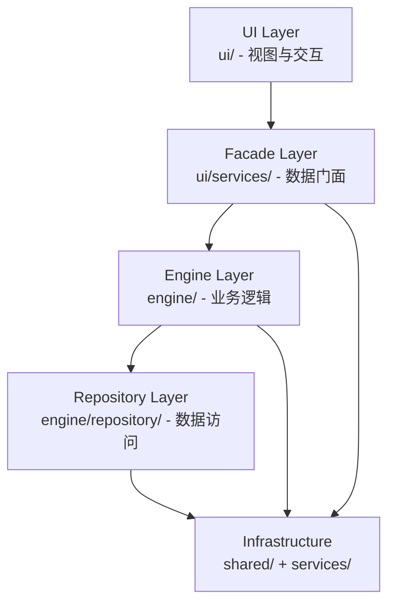

# 小说工坊 AI 插件架构文档

> **版本**: v4.14.0  
> **最后更新**: 2026-10-25  
> **状态**: 活跃可信 · 与代码同步

本文档描述 Novel Writer AI Obsidian 插件的分层架构、依赖关系、数据流和关键设计决策，帮助开发者快速理解整体结构。

---

## 一、分层架构图

```
┌─────────────────────────────────────────────────────────────────────────────┐
│                           UI Layer (ui/)                                    │
│   视图、模态框、面板、用户交互                                                │
│   - views/  components/  full-writer/  cowrite/  services/                  │
├─────────────────────────────────────────────────────────────────────────────┤
│                           Facade Layer (ui/services/)                       │
│   统一数据查询门面，隐藏底层实现细节                                           │
│   - co-write-facade.ts                                                      │
├─────────────────────────────────────────────────────────────────────────────┤
│                          Engine Layer (engine/)                             │
│   业务逻辑、核心服务、流程生成、缓存、质量监控                                  │
│   - co-writer/  streaming/  cache/  performance/  quality/                  │
│   - repository/domain/ (聚合根、值对象、序列化器)                              │
│   - ai-engine.ts  co-writer-engine.ts  engine-registry.ts                   │
├─────────────────────────────────────────────────────────────────────────────┤
│                     Repository Layer (engine/repository/)                   │
│   统一数据访问层，封装 Markdown + Frontmatter 持久化                           │
│   - interfaces.ts (IRepository / IBulkRepository)                           │
│   - base-markdown-repository.ts (抽象基类)                                   │
│   - 6 个实现: project/chapter/character/faction/location/item               │
├─────────────────────────────────────────────────────────────────────────────┤
│                    Infrastructure (shared/  services/)                      │
│   平台适配、状态管理、文件系统抽象、工具函数                                   │
│   - shared/store/ (仿 Zustand 状态管理)                                      │
│   - shared/file-system-port.ts (ObsidianFileSystem)                         │
│   - shared/paths.ts  shared/frontmatter.ts  shared/types.ts                 │
└─────────────────────────────────────────────────────────────────────────────┘
```

### Mermaid 版本



---

## 二、各层职责说明

### 1. UI Layer (`ui/`)

**职责**: 渲染界面、响应用户操作、调用 Facade 获取数据。

- 不直接访问 `plugin.engine.*` 或 `app.vault`
- 通过 `CoWriteFacade` 获取数据
- 包含视图（Views）、模态框（Modals）、面板（Panels）、完整写作器（Full Writer）

**关键文件**:
- `ui/co-writing-view.ts` — 句级协同写作视图
- `ui/full-writer-view.ts` — 完整写作工作台
- `ui/views/knowledge-base-view.ts` — 知识库管理视图
- `ui/views/knowledge-base-modals.ts` — 知识库 Modal（导入/编辑书籍、题材编辑、批量操作）
- `ui/views/writing-fingerprint-view.ts` — 写作指纹库视图

**`ui/full-writer/` 子目录** — 工作台控制器集合：
| 文件 | 功能 |
|------|------|
| `tab-controller.ts` | 标签管理（切换/打开） |
| `project-selector-controller.ts` | 项目选择器页面 |
| `wizard-controller.ts` | 项目向导流程 |
| `context-loader-controller.ts` | 上下文加载与刷新 |
| `outline-tree-controller.ts` | 大纲树渲染排序 |
| `entity-state-controller.ts` | 实体状态变更 |
| `setting-lib-controller.ts` | 设置库管理 |
| `full-writer-state.ts` | 工作台状态接口 |
| `full-writer-store.ts` | 工作台状态 Store |

### 2. Facade Layer (`ui/services/`)

**职责**: 为 UI 层提供统一的数据查询接口，隐藏 Engine、Repository、SessionStore 的细节。

- 封装 `EngineRegistry`、`CoWriterEngine`、各 Repository 的访问
- 持有 `CoWritingSessionStore` 实例，供 UI 订阅
- Facade 不可用时回退到直接访问 `plugin`（向后兼容）
- 只负责数据查询，不包含 UI 渲染逻辑

**关键文件**:
- `ui/services/co-write-facade.ts` — Facade 实现

### 3. Engine Layer (`engine/`)

**职责**: 业务逻辑、核心服务、流程生成、缓存、质量监控。

- `engine-registry.ts` — 集中管理所有引擎实例（单例 + 懒加载 + 项目级缓存）
- `co-writer/` — 协同写作会话状态构建（基于 Store）
- `streaming/` — 流式生成（原生 SSE + 模拟流 + 降级策略）
- `cache/` — 多层缓存体系（L1 内存 + L2 文件 + 预加载）
- `performance/` — 性能监控节点
- `quality/` — 实时监控 V2 引擎集合
  - `quality-score-engine.ts` — 六维质量评分引擎
  - `deviation-detector.ts` — 偏离检测引擎（角色偏离 + 3 层预警）
- `repository/domain/` — 聚合根（Character/Chapter/Project/Faction/Location/Item）、值对象、序列化器

**关键文件**:
- `engine/engine-registry.ts` — 引擎注册表（9 阶段初始化，作用域/依赖验证/dispose/元数据）
- `engine/co-writer/session-state.ts` — 会话状态接口（5 个切片）
- `engine/co-writer/create-session-store.ts` — Store 工厂
- `engine/streaming/stream-parser.ts` — 流式解析器
- `engine/cache/multi-layer-cache.ts` — 多层缓存
- `engine/quality/quality-score-engine.ts` — 核心质量评分引擎
- `engine/quality/deviation-detector.ts` — 偏离检测引擎

### 4. Repository Layer (`engine/repository/`)

**职责**: 统一数据访问层，封装 Markdown + Frontmatter 的持久化。

- 定义泛型接口 `IRepository<T, TId>` 和 `IBulkRepository<T, TId>`
- 抽象基类 `BaseMarkdownRepository` 封装通用 CRUD + 批量操作 + LRU 缓存
- 子类只需实现 4 个抽象方法：`idFromEntity` / `filePathFromId` / `deserialize` / `serialize`
- 内置 LRU 缓存 + 可选多层缓存（`MultiLayerCache`）
- 基于 `FileSystemPort` 抽象，与 Obsidian 平台解耦

**接口定义** (`engine/repository/interfaces.ts`):

```typescript
export interface IRepository<T, TId> {
    findById(id: TId): Promise<T | null>;
    findAll(): Promise<T[]>;
    save(entity: T): Promise<T>;
    delete(id: TId): Promise<boolean>;
    exists(id: TId): Promise<boolean>;
}

export interface IBulkRepository<T, TId> extends IRepository<T, TId> {
    saveAll(entities: T[]): Promise<BulkResult<T>>;
    deleteAll(ids: TId[]): Promise<BulkResult<TId>>;
    findAllById(ids: TId[]): Promise<T[]>;
}
```

**6 个 Repository 实现**:

| Repository | 作用域 | 数据 | 特定查询方法示例 |
|-----------|--------|------|------------------|
| `ProjectRepository` | 全局 | 项目元数据 | `findByGenre` / `findByType` / `findByAuthor` |
| `ChapterRepository` | 项目级 | 章节正文 | `findByVolume` / `findByStatus` / `findChaptersByCharacter` |
| `CharacterRepository` | 项目级 | 人物 | `findByFaction` / `findByIdentity` / `findByCurrentLocation` |
| `FactionRepository` | 项目级 | 势力 | `findByLeader` / `findByType` |
| `LocationRepository` | 项目级 | 地点 | `findByRegion` / `findByImportance` |
| `ItemRepository` | 项目级 | 物品法术 | `findByOwner` / `findByGrade` |

### 5. Infrastructure (`shared/` + `services/`)

**职责**: 平台适配、状态管理、文件系统抽象、工具函数。

- `shared/store/` — 仿 Zustand 的状态管理（`createStore` + `subscribeWithSelector` + 中间件）
  - 持久化中间件：Obsidian 插件设置 / IndexedDB
- `shared/file-system-port.ts` — 文件系统抽象接口（`IFileSystemPort`）
  - 实现：`ObsidianFileSystem`（生产）/ `MockFileSystem`（测试）
- `shared/paths.ts` — 标准化路径工具函数（`pjCharFile` / `pjBodyFile` 等）
- `shared/frontmatter.ts` — Frontmatter 解析
- `shared/entity-models.ts` — 实体领域模型类型
- `services/` — 应用服务（KnowledgeBaseManager / PerformanceMonitor 等）

---

## 三、依赖规则

**核心规则：依赖只能向下流动，不允许反向引用。**

```
UI Layer → Facade Layer → Engine Layer → Repository Layer → Infrastructure
    │             │                 │                  │                 │
    │             │                 │                  │                 │
    └─────────────┴─────────────────┴──────────────────┴─────────────────┘
                                    ↓
                              可互访（同层）
```

### 访问边界

| 层 | 允许访问 | 禁止访问 |
|----|---------|---------|
| UI Layer | Facade | Engine 内部、Repository 实现 |
| Facade Layer | Engine、Repository、Store | UI 组件 |
| Engine Layer | Repository、Infrastructure | UI 组件、Facade |
| Repository Layer | Infrastructure (FileSystemPort) | Engine 业务逻辑 |
| Infrastructure | 自身 | 任何上层 |

### 跨层访问的合法方式

1. **UI 通过 Facade 查询**: UI → Facade → Engine
2. **Engine 通过 Repository 查询数据**: Engine → Repository → FileSystemPort
3. **EngineRegistry 跨层管理**: 注册所有 Repository 实例，供 Facade/Engine 获取

### 违反规则的标志

- 在 `engine/` 中 `import 'obsidian'` ❌（应通过 `FileSystemPort`）
- 在 `ui/` 中直接 `new CharacterRepository(...)` ❌（应通过 Facade）
- 在 `repository/` 中调用 `engine/` 的业务逻辑 ❌（Repository 只负责数据查询）

---

## 四、引擎注册表（EngineRegistry）

### 概述

`EngineRegistry` 是插件的核心组件管理器，负责集中管理所有引擎实例的生命周期。

**核心能力**:
- 单例模式：整个插件生命周期共享一个实例
- 懒加载：首次获取时才创建实例
- 项目级作用域：每个项目独立实例，切换项目时释放旧实例
- 瞬态作用域：每次获取创建新实例
- 依赖声明与拓扑校验：`verifyDependencies()`
- Dispose 机制：`dispose` / `disposeProject` / `disposeAll`
- 元数据查询：`listEngines` / `getMetadata`

### 引擎名称常量

所有引擎通过 `ENGINE_NAMES` 常量注册，避免拼写错误：

```typescript
export const ENGINE_NAMES = {
    CACHE_MANAGER: 'cacheManager',
    INTERNAL_REGISTRY: 'internalRegistry',
    CRYPTO_SERVICE: 'cryptoService',
    PROVIDER_MANAGER: 'providerManager',
    THEME_MANAGER: 'themeManager',
    SETTINGS_SERVICE: 'settingsService',
    CONTEXT_MANAGER: 'contextManager',
    FORESHADOW_MANAGER: 'foreshadowManager',
    REVIEW_AGENT: 'reviewAgent',
    COMMAND_REGISTRY: 'commandRegistry',
    KNOWLEDGE_TAG_MANAGER: 'knowledgeTagManager',
    KNOWLEDGE_BASE_MANAGER: 'knowledgeBaseManager',
    KNOWLEDGE_VECTOR_STORE: 'knowledgeVectorStore',
    VECTOR_ENHANCER: 'vectorEnhancer',
    DECONSTRUCTION_SCHEDULER: 'deconstructionScheduler',
    HEAVY_TASK_WORKER_MANAGER: 'heavyTaskWorkerManager',
    BATCH_IMPORT_MANAGER: 'batchImportManager',
    WRITING_PROFILE_MANAGER: 'writingProfileManager',
    KNOWLEDGE_INJECTOR: 'knowledgeInjector',
    CHARACTER_CONSISTENCY_CHECKER: 'characterConsistencyChecker',
    AI_ENGINE: 'aiEngine',
    CO_WRITER_ENGINE: 'coWriterEngine',
    CO_WRITING_SESSION_STORE: 'coWritingSessionStore',
    ANALYSIS_REPORT_ENGINE: 'analysisReportEngine',
    SETTLEMENT_ENGINE: 'settlementEngine',
    CHARACTER_GENERATOR: 'characterGenerator',
    WORLDVIEW_CACHE_SERVICE: 'worldviewCacheService',
    UPDATE_CHECKER: 'updateChecker',
    TEMPLATE_SERVICE: 'templateService',
    CHAPTER_VERSION_SERVICE: 'chapterVersionService',
    TEMPLATE_MANAGER: 'templateManager',
    CHARACTER_REPOSITORY: 'characterRepository',
    CHAPTER_REPOSITORY: 'chapterRepository',
    PROJECT_REPOSITORY: 'projectRepository',
    FACTION_REPOSITORY: 'factionRepository',
    LOCATION_REPOSITORY: 'locationRepository',
    ITEM_REPOSITORY: 'itemRepository',
} as const;
```

### 9 阶段初始化顺序

引擎按以下顺序初始化，确保依赖关系正确：

| 阶段 | 引擎 | 职责 |
|------|------|------|
| Phase 1 | PluginCacheManager | 缓存管理器 |
| Phase 2 | InternalRegistry, CryptoService, ProviderManager, ThemeManager, SettingsService | Core 服务 |
| Phase 3 | ProjectRepository, ContextManager, ForeshadowManager, ReviewAgent, WorldviewCacheService, TemplateService, ChapterVersionService, TemplateManager | 基础引擎 |
| Phase 4 | CommandRegistry | 命令注册表 |
| Phase 5 | SettingsService.loadSettings() | 设置加载 |
| Phase 6 | KnowledgeTagManager, KnowledgeBaseManager, KnowledgeVectorStore, VectorEnhancer, DeconstructionScheduler, HeavyTaskWorkerManager, BatchImportManager | 知识库系统 |
| Phase 7 | WritingProfileManager, KnowledgeInjector, CharacterConsistencyChecker | 写作配置与知识注入 |
| Phase 8 | AIEngine, CoWriterEngine, AnalysisReportEngine, SettlementEngine, CharacterGenerator | 懒加载引擎注册 |
| Phase 9 | UpdateChecker | 更新检查器 |

### 懒加载引擎

以下引擎采用懒加载模式，首次调用 `get()` 时才创建实例：

| 引擎 | 创建条件 |
|------|---------|
| AIEngine | 首次调用 `plugin.aiEngine` |
| CoWriterEngine | 首次调用 `plugin.coWriterEngine` |
| AnalysisReportEngine | 首次调用 `plugin.analysisReportEngine` |
| SettlementEngine | 首次获取结算引擎 |
| CharacterGenerator | 首次获取角色生成器 |

---

## 五、数据流图

### 用户操作 → 数据持久化（写入流）

```
用户在 UI 输入内容
    │
    ▼
UI 组件 (cowriting-view.ts)
    │
    ├─→ facade.updateSnapshot(text)
    │
    ▼
CoWriteFacade
    │
    ├─→ engine.updateSnapshot()
    │
    ▼
CoWriterEngine
    │
    ├─→ 内部更新 session 状态 + 触发建议生成
    ├─→ store.setState({ chapterContent: text })
    │
    ▼
CoWritingSessionStore
    │
    ├─→ persist 中间件捕获变更
    ├─→ partializeCoWritingState 提取需持久化字段
    │
    ▼
ObsidianSettingStorage
    │
    ├─→ plugin.saveSettings()
    │
    ▼
data.json (Obsidian 插件配置文件)
```

### 用户操作 → 数据读取（查询流）

```
用户切换章节
    │
    ▼
UI 组件调用 facade.thunks.fetchChapter(project, vol, chap)
    │
    ▼
CoWritingSessionStore.dispatch(thunk)
    │
    ▼
thunk 内部调用 deps.chapterRepository.loadChapter(...)
    │
    ▼
ChapterRepository.findById(id)
    │
    ├─→ 1. 检查 L1 LruCache（命中则返回）
    ├─→ 2. 检查 L2 MultiLayerCache（命中则写入 L1 后返回）
    └─→ 3. 调用 fs.read(filePath)
    │
    ▼
ObsidianFileSystem.read(path)
    │
    ├─→ app.vault.cachedRead(file)
    │
    ▼
Chapter 实体返回
    │
    ├─→ deserialize(content, filePath)
    ├─→ 1. 写入 L1 缓存
    ├─→ 2. 写入 L2 缓存（如启用）
    │
    ▼
Store.setState({ chapterTitle, chapterContent, ... })
    │
    ▼
UI 组件通过 subscribeWithSelector 收到更新
    │
    ▼
界面渲染
```

### 流式生成数据流

```
UI 触发建议生成
    │
    ▼
facade.suggestStream(text, hint, mode, dirIdx, signal)
    │
    ▼
CoWriteFacade
    │
    ├─→ engine.suggestStream()
    │
    ▼
CoWriterEngine
    │
    ├─→ aiEngine.callAIAsyncIterator(...)
    │
    ▼
AIApiClient.callAIAsyncIterator
    │
    ├─→ 阶段 1: 原生 SSE 流式
    │     ├─→ 成功 → yield chunks
    │     └─→ 失败 → 降级阶段 2
    │
    ├─→ 阶段 2: 模拟流式（一次性请求 + 分块）
    │     ├─→ 成功 → yield chunks
    │     └─→ 失败 → 降级阶段 3
    │
    └─→ 阶段 3: 完整响应（非流式）
    │
    ▼
UI 组件 for await (const chunk of stream) { ... }
    │
    ├─→ 将 chunk 渲染到编辑器
    │
    ▼
用户看到流式输出
```

---

## 六、核心模块详解

### 1. 状态管理（shared/store/）

项目实现了一套仿 Zustand 的状态管理系统，无需外部依赖。

**核心文件**:
- `shared/store/createStore.ts` — 核心 Store（getState/setState/subscribe/destroy）
- `shared/store/createStore.ts` — `subscribeWithSelector` 增强选择器订阅
- `shared/store/compose.ts` — 中间件组合（`compose` + `applyMiddleware`）
- `shared/store/middleware/` — 4 个中间件实现
  - `logger.ts` — 日志中间件
  - `persist.ts` — 持久化中间件（支持 Obsidian 设置 / IndexedDB）
  - `devtools.ts` — 开发工具中间件
  - `thunk.ts` — Thunk 中间件（支持异步 action）

**使用方式**:
```typescript
import { createStore } from '../shared/store';

const store = createStore({
    chapterContent: '',
    chapterTitle: '',
}, {
    middleware: [logger, persist({ storage: createObsidianSettingStorage() })],
});
```

### 2. 文件系统抽象（shared/file-system-port.ts）

**目的**: 将文件操作与 Obsidian 平台解耦，便于测试和扩展。

**接口定义**:
```typescript
export interface FileSystemPort {
    read(path: string): Promise<string>;
    write(path: string, content: string): Promise<void>;
    delete(path: string): Promise<void>;
    exists(path: string): Promise<boolean>;
    listFiles(path: string): Promise<{ path: string; mtime: number }[]>;
    mkdir(path: string): Promise<void>;
}
```

**实现**:
- `ObsidianFileSystem` — 生产环境实现，封装 `app.vault`
- `MockFileSystem` — 测试环境实现，使用内存文件系统

### 3. 缓存体系（engine/cache/）

**两层缓存架构**:

| 层级 | 实现 | 存储位置 | TTL | 容量 |
|------|------|---------|-----|------|
| L1 | LruCache | 内存 | 5 分钟 | 100 条目 |
| L2 | MultiLayerCache | 文件系统 | 可配置 | 无限制 |

**核心文件**:
- `engine/cache/multi-layer-cache.ts` — 多层缓存
- `engine/cache/file-cache.ts` — 文件级缓存（L2）
- `engine/cache/preload-manager.ts` — 智能预加载
- `engine/repository/lru-cache.ts` — LRU 缓存（L1）

### 4. 协同写作会话状态（engine/co-writer/）

会话状态分为 5 个切片，独立管理：

| 切片 | 内容 | 持久化 |
|------|------|--------|
| chapter | 章节内容、标题、路径 | 是 |
| suggestion | AI 建议、草稿、历史 | 否 |
| editor | 编辑器状态、光标位置 | 否 |
| metrics | 质量指标、风格评分 | 是 |
| ui | UI 布局、面板状态 | 是 |

### 5. 知识库系统（services/ + engine/）

知识库系统是插件的核心模块之一，负责管理参考书籍的导入、拆解、向量索引和相似性检索。

**系统组成**:

| 组件 | 文件 | 职责 |
|------|------|------|
| KnowledgeBaseManager | `services/knowledge-base-manager.ts` | 书籍 CRUD、索引管理、状态管理 |
| DeconstructionScheduler | `services/deconstruction-scheduler.ts` | 拆解任务调度、并发控制、进度管理；v8.0 起读取 `NovelWriterSettings.deconstructionEngine`（增强级别/维度/向量/LLM/性能），通过 `getDeconstructionEngineSettings()` 系列方法暴露给运行时 |
| QualityScorer | `engine/quality-scorer.ts` | 三维质量评分（完整性·一致性·置信度）、9 条跨维度交叉验证、shouldUpgrade 升级建议 |
| KnowledgeVectorStore | `services/knowledge-vector-store.ts` | 向量索引构建与相似性检索 |
| VectorEnhancer | `engine/vector-enhancer.ts` | 向量增强与维度融合 |
| KnowledgeInjector | `engine/knowledge-injector.ts` | 写作时知识注入与上下文扩充 |
| KnowledgeTagManager | `services/knowledge-tag-manager.ts` | 题材标签管理与分类 |
| BatchImportManager | `services/batch-import-manager.ts` | 批量导入管理 |
| HeavyTaskWorkerManager | `services/heavy-task-worker-manager.ts` | 重量级任务 Worker 池 |

**存储结构**:
```
知识库根目录/
├── index.md                    # 总索引（frontmatter 存 JSON）
├── 书籍A/
│   ├── 基本信息.md             # 书籍元数据
│   ├── 风格指纹.md             # 风格拆解结果
│   ├── 节奏分析.md             # 节奏拆解结果
│   ├── 写作技巧.md             # 技巧拆解结果
│   ├── 结构拆解.md             # 结构拆解结果
│   ├── 人物提取.md             # 人物拆解结果
│   ├── 伏笔库.md               # 伏笔拆解结果
│   └── 向量索引/               # 向量索引文件
└── 书籍B/
    └── ...
```

**v4.10.1 加固要点**:
- **数据安全**：递归删除、路径穿越防护、同名检测、原子改名、索引损坏自动重建
- **调度可靠性**：Watchdog 活性检测、pause 正确取消、资源泄漏修复、竞态条件修复
- **性能优化**：进度 debounce、写放大优化、Map 定期清理、监听器幂等
- **用户体验**：按钮状态反馈、统一确认弹窗、友好错误提示、搜索框焦点修复

**拆解维度**（6 维度）:
1. 风格（style）— 文笔风格指纹
2. 节奏（rhythm）— 叙事节奏分析
3. 技巧（technique）— 写作技巧提取
4. 结构（structure）— 情节结构拆解
5. 人设（character）— 人物形象提取
6. 伏笔（foreshadow）— 伏笔库构建

**状态机**:
```
pending → processing → completed
    ↓         ↓
paused     failed/interrupted
    ↓
processing (恢复)
```

---

## 七、架构决策记录（ADR）

### ADR-001：选择 Repository 模式

**状态**: 已采纳

**背景**:
- 18 个 engine 文件直接 `import 'obsidian'` 并操作 `app.vault`
- 业务逻辑与文件操作耦合在一起，难以测试
- 没有缓存层，重复读取同一文件浪费性能
- frontmatter 字段写错在运行时才暴露

**方案**: 引入 Repository 模式，统一数据访问层：
- 定义泛型接口 `IRepository<T, TId>` 和 `IBulkRepository<T, TId>`
- 抽象基类 `BaseMarkdownRepository` 封装通用逻辑（CRUD + 批量 + LRU 缓存）
- 子类只需实现 4 个抽象方法（`idFromEntity` / `filePathFromId` / `deserialize` / `serialize`）
- 通过 `FileSystemPort` 抽象与 Obsidian 平台解耦

**理由**:
1. **可测试性**: Repository 接口可 Mock，业务逻辑可在无 Obsidian 环境下测试
2. **性能**: 内存 LRU 缓存 + 多层缓存，减少重复文件读取
3. **类型安全**: 领域模型类型化，frontmatter 字段错误在编译期暴露
4. **关注点分离**: 业务逻辑只关注领域对象，不关注文件读取细节

**代价**:
- 增加了一层抽象，新开发者需要理解 Repository 模式
- 现有代码需要渐进迁移（双轨制渐进式）

**迭代方案**:
- 直接重构所有引擎：风险太大，一次改动影响太多
- 不做任何改变：技术债务持续累积

### ADR-002：自建 Store 而非使用 Zustand

**状态**: 已采纳

**背景**: 协同写作会话需要复杂的状态管理：
- 5 个状态切片（chapter / suggestion / editor / metrics / ui）
- 部分状态需持久化（chapter / metrics / ui），部分为内存态（suggestion / editor）
- 需要中间件链管理（logger / persist / devtools / thunk）
- 需要选择器订阅以避免不必要的渲染

**方案**: 自建仿 Zustand 的状态管理（`shared/store/`），仿造灵感来自 Zustand 但无外部依赖。

**理由**:
1. **Obsidian 插件约束**: 插件运行在 Obsidian 沙箱中，需避免外部依赖冲突
2. **体积控制**: 自建 Store 仅 ~500 行代码，Zustand 压缩后约 1KB，但增加依赖管理负担
3. **完全可控**: 可针对 Obsidian 定制持久化中间件（`createObsidianSettingStorage`）
4. **中间件机制**: 参考 Redux/Zustand 设计，支持 logger / persist / devtools / thunk
5. **类型安全**: 完整 TypeScript 泛型支持，无 `any` 漏洞

**代价**:
- 需自行维护中间件体系
- 社区生态不如 Zustand 丰富

**替代方案**:
- Zustand: 增加外部依赖，与 Obsidian 插件体积控制冲突
- Redux: 过于重量级，样板代码过多
- 不用状态管理: UI 状态散落在各处，难以维护

### ADR-003：双轨制渐进式迁移策略

**状态**: 已采纳

**背景**: 插件已有大量功能代码直接操作 `app.vault`，无法一次性迁移到 Repository 模式。

**方案**: 采用双轨渐进式迁移：
1. **新版代码**: 必须使用 Repository / Store / Facade
2. **旧版代码**: 保留原有逻辑，同时添加 Repository 路径作为优先选项
3. **Fallback 机制**: Repository 不可用时回退到原有逻辑
4. **性能节点**: 记录 Repository 命中率，量化迁移收益

**迁移阶段**:
| 阶段 | 内容 | 状态 |
|------|------|------|
| Phase 1 | 基础设施实现（Repository 接口、Store、FileSystemPort） | 已完成 |
| Phase 2 | ContextManager 迁移 | 已完成 |
| Phase 3 | 实体相关引擎（EntityContextEngine、CharacterConsistencyChecker） | 进行中 |
| Phase 4 | 章节相关引擎（ChapterContextBuilder、OutlineToTextExpander） | 待开始 |
| Phase 5 | 其他引擎 | 待开始 |

**理由**:
1. **低风险**: 每次只迁移一个引擎，可独立测试
2. **可回滚**: 保留 Fallback 路径，迁移失败可立即回退
3. **可量化**: 性能节点显示 Repository 命中率，证明迁移收益
4. **不阻塞新功能**: 新功能直接使用新架构，不等旧代码迁移完成

**代价**:
- 短期内代码量增加（双路径并存）
- 需维护两套逻辑的一致性

---

## 八、关键文件索引

### 架构核心
- `engine/engine-registry.ts` — 引擎注册表（9 阶段初始化，作用域/依赖验证/dispose/元数据）
- `.engine-registry-whitelist.json` — 实例化白名单配置
- `scripts/scan-engine-instances.mjs` — 实例化扫描与合规检查（`--check` 模式可集成 CI）
- `ui/services/co-write-facade.ts` — UI 数据查询门面
- `shared/file-system-port.ts` — 文件系统抽象（`IFileSystemPort` / `ObsidianFileSystem` / `MockFileSystem`）

### Repository 层
- `engine/repository/interfaces.ts` — `IRepository` / `IBulkRepository` 接口
- `engine/repository/base-markdown-repository.ts` — 抽象基类
- `engine/repository/{character,chapter,project,faction,location,item}-repository.ts` — 6 个实现
- `engine/repository/domain/aggregates/` — 聚合根（`BaseEntity` / `Character` / `Chapter` / ...）
- `engine/repository/domain/serializers/entity-factory.ts` — `EntityFactory`（fromMarkdown / toMarkdown）
- `engine/repository/MIGRATION.md` — Repository 迁移指南

### Store 状态管理
- `shared/store/createStore.ts` — `createStore` / `subscribeWithSelector`
- `shared/store/compose.ts` — `compose` / `applyMiddleware`
- `shared/store/middleware/` — logger / persist / devtools / thunk
- `engine/co-writer/session-state.ts` — 协同写作状态接口（5 个切片）
- `engine/co-writer/create-session-store.ts` — Store 工厂

### 流式生成
- `engine/streaming/stream-parser.ts` — SSE / Ollama 流式解析
- `engine/streaming/simulated-stream.ts` — 模拟流式
- `engine/ai-api-client.ts` — `callAIAsyncIterator`（三阶段降级）

### 缓存体系
- `engine/cache/multi-layer-cache.ts` — 多层缓存（L1 + L2）
- `engine/cache/file-cache.ts` — 文件级缓存（L2）
- `engine/cache/preload-manager.ts` — 智能预加载
- `engine/repository/lru-cache.ts` — LRU 缓存（L1）

### 性能监控
- `services/performance-monitor.ts` — 唯一性能监控实现（分层埋点、慢操作、报告）

### 开发文档
- `docs/ARCHITECTURE.md` — 本文件
- `docs/DEVELOPMENT.md` — 开发指南
- `docs/PERFORMANCE.md` — 性能优化指南
- `docs/API.md` — API 参考
- `engine/repository/MIGRATION.md` — Repository 迁移指南
