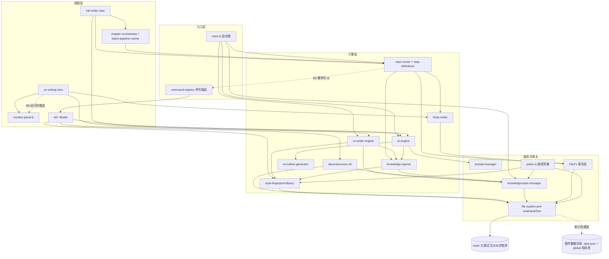

# 交互/界面审计 + 模块生产消费关系（2026-11-20）

> 状态：活跃 · 2026-11-20
>
> 任务：ZC-20261120-24（阶段一：只产出结论，不动 `ui/` 代码——避免与在跑的 i18n 切片抢写锁）。
> 执行：ZCode。方法：双通道收集（定向 grep + 全量扫描交叉验证），全部证据为代码事实（文件:行）。
> 值得记录的一次自我修正：初版审计认为「Ctrl+S 快捷键不存在」（grep 模式漏了
> `editor-shortcuts.ts` 的抽象映射层），交叉验证后发现快捷键存在但行为三处不一致、
> 且仅编辑器焦点内生效——**最终版按修正后的事实写**（见 A-2）。
> 阶段二（按 §三 C 清单逐项改造）另行派单。

## 〇、范围与方法

覆盖面：full-writer 工作台、知识库视图、监控面板（A/B）、写作指纹库、设置页、弹窗层（40+ Modal）、悬浮面板。
优先级定义：**P0** 数据丢失/重复扣费/功能不可用；**P1** 承诺与实际不符/明显不一致/易触发；**P2** 风格不统一/可维护性。

一个贯穿性的背景事实：仓库**自己承认**了多处不一致——
`ui/button-busy.ts:1-8` 自述「各面板手写 disabled=true 模式不一致，连点会叠开 Modal」、
`ui/mini-settings-modal.ts:5` 自述「与 settings-tab 双份维护，字段校验与保存语义经常漂移」、
`ui/co-writing/save-state.ts:1-8` 记录了中文状态串导致的历史 bug。
**审计发现不是新闻，是这些自述的系统性展开。**

---

## 一、A：交互与前端界面审计（20 条）

### A-1 重型 AI 生成弹窗无防重复提交（P0）

- **现象**：`plan-book-modal`（全书规划）与 `ai-builder-modal`（批量实体生成）生成期间按钮不禁用、无 `isGenerating` 守卫、文案不变——双击 = 两次完整 AI 调用。
- **证据**：两文件 `disabled` 出现 **0** 次、`isGenerating|pending` **0** 次、「生成中」文案 **0** 次。对照：`golden-opening-modal` 有 `isGenerating*` 守卫（全仓 35 处）+ 7 处 disabled；仓库有现成统一助手 `ui/button-busy.ts`（`withButtonBusy`，文件头自述动机），但手写 `disabled` 全库仍有 **171 处**。
- **影响**：全书规划单次调用上万 token，双击直接双倍费用；两个响应竞态写 `分卷大纲/第N卷_分卷大纲.md`。
- **建议**：`withButtonBusy` 已存在，接入即可；优先接入 5 个无守卫的重型生成弹窗。
- **预估**：0.5 天工具推广 + 0.5 天接入验证。

### A-2 Ctrl+S 三处行为不一致，且仅编辑器焦点内生效（P1，交互不一致）

- **现象**：同一个 Ctrl+S，三个编辑面三种行为；且绑定都在编辑器元素上，焦点在 UI 控件时失效（按钮 tooltip 却承诺了它）。
- **证据**：
  - 绑定层：`ui/co-writing/editor-shortcuts.ts:81`（`mod+s → {kind:'save'}`，挂在 `co-writing-view.ts:1074` 的 `rightEditor` keydown）；`ui/co-writing/save-state.ts`（悬浮面板已于 2026-11 后模块化拆入 ui/co-writing/*，浮窗本体移除）；`ui/full-writer/unit-writer-controller.ts:271`
  - 行为差异：协同视图 = 推撤销快照 + 成功 Notice（`co-writing-view.ts:1744-1747`）；全文写作台 = 仅 flush + Notice，**不推快照**；悬浮面板 = **静默**（仅状态字变化，`:308`）
  - 承诺：`ui/co-writing/control-panel.ts:22` tooltip「立即保存当前正文（Ctrl+S）」（资源 `cowrite.panel.tipSave`）——按钮在编辑器**外**，焦点不在编辑器时 Ctrl+S 落到 Obsidian 全局
  - Obsidian 命令体系：全仓 `hotkeys:` 注册 **0** 处
- **影响**：用户按 tooltip 提示在非编辑器焦点按 Ctrl+S，实际触发 Obsidian 自身保存；三个界面学到的肌肉记忆互相打架（协同推快照 → 悬浮面板静默，用户以为没保存）。
- **建议**：①统一三处行为（是否推快照、是否有成功反馈）；②tooltip 承诺的快捷键要么全局接管（`registerDomEvent(document, 'keydown')` + 视图激活判断）要么文案去掉。
- **预估**：1 天。

### A-3 同一协同正文，两个入口的丢失风险策略不同（P0/P1，交互不一致）

- **现象**：主视图编辑器 2 秒防抖自动保存；**悬浮面板编辑同一正文却完全没有自动保存**——输入后只把状态字改成「编辑中」，之后全靠用户手动点 💡 保存或按 Ctrl+S（且静默）。
- **证据**：主视图 `ui/co-writing-view.ts:1095`（input → `scheduleAutoSave()`，`:3469-3474` `debounceFixed("auto-save", …, 2000)`）；悬浮面板 `ui/co-write-floating-panel.ts:210-214`（input 仅 `updateSnapshot/updateSaveState("编辑中")`），全文件无 debounce/autoSave 实现。 <!-- anchor-ok: 历史记述（2026-11-20 证据，浮窗本体已拆） -->
- **影响**：用户从悬浮面板快速记笔记，关面板 = 未保存内容丢失；而同样操作在主视图是安全的。**同一份正文，丢失风险取决于从哪个入口编辑。**
- **建议**：悬浮面板接入同一 `BodySaveController`（或至少同一防抖保存）。
- **预估**：0.5 天（控制器已抽好，接 host 接口即可）。

### A-4 正文自动保存节拍三套并存（P2，交互不一致）

- **现象**：三个正文编辑面三种防抖时长、三种实现机制。
- **证据**：协同主视图 **2000ms**（`co-writing-view.ts:3469`，`debounceFixed`）；全文写作台单元写作 **800ms**（`unit-writer-controller.ts:40` `AUTOSAVE_DELAY_MS`）；场景大纲 **1000ms**（`scene-outline-controller.ts:1005-1011`，裸 `window.setTimeout`）。
- **影响**：用户感知不一致（哪个界面「改完等多久才存」不同）；三套实现维护三倍。
- **建议**：统一常量 + 统一 debounce 实现（协同的 `debounceFixed` 已是标准件）。
- **预估**：0.5 天。

### A-5 42 个含编辑区的 Modal，关闭时无一确认未保存（P0/P1）

- **现象**：Esc/点外部关闭 Modal 直接丢弃输入；全库 `onClose` 中检查 dirty/未保存的为 **0**。唯一对未保存内容有反应的是 `existing-entity-manager.ts:72-77`——但它也只是弹 Notice「已丢弃」后照丢，**无确认机会**。
- **证据**：`grep -rln onClose ui/` → 106 文件；含 dirty 检查 → 0。含 `createEl('textarea')` 的 Modal → 42 个（`writing-style-modal` 八节表单、`add-fanfic-setting-modal`、`plan-book-modal` 自定义提示词、`golden-opening-modal` 六个输入区等）。静默丢弃代表：`template-manager.ts:567`、`fingerprint-intensity-modal.ts:97`、`rebuild-chapters-modal.ts:348`、`batch-create-modal.ts:511`、`mini-settings-modal.ts:103`。
- **影响**：弹窗表单写了大段内容，误触 Esc 全丢且不可恢复（`writing-style-modal` 的表单保存到项目文件，丢失即重打）。
- **建议**：统一 `confirmDiscardIfDirty` 钩子（跟踪 form dirty），先接入高危 10 个。
- **预估**：1 天工具 + 0.5 天接入。

### A-6 确认框四套机制并存（P1，交互不一致）

- **现象**：`window.confirm`（11 处/8 文件，全部在 `ui/`）、自研 `OperationConfirmModal`（35 文件引用，支持「不再提示」rememberKey）、两个一次性专用 Modal（`RollbackConfirmModal` 仅回滚、`SceneConfirmModal` 仅场景确认）。
- **证据**：`window.confirm` 全清单：`add-fanfic-setting-modal.ts:631,747`、`ai-builder-modal.ts:537`、`advanced-maintenance-modal.ts:202`、`novel-tags-modal.ts:87`、`rebuild-chapters-modal.ts:182`、`quality-loop-modal.ts:132`、`settlement-recovery-modal.ts:85`、`volume-intro-modal.ts:161`、`full-writer/wizard-controller.ts:383`、`unified-entity-manager-modal.ts:204`。
- **影响**：原生 confirm 阻塞主线程、样式割裂、绕过 i18n 样式体系、无法「不再提示」。
- **建议**：`window.confirm` 11 处机械替换到 `OperationConfirmModal`；两个专用 Modal 评估是否值得并入（场景确认有特殊交互，可保留）。
- **预估**：0.5 天。

### A-7 同类「删除」操作按入口分裂确认强度（P1，交互不一致）

- **现象**：删项目 = 两步专用确认弹窗；删渠道/预设/提示词 = `OperationConfirmModal`；删版本 = 原生 `window.confirm`；回滚版本 = 专用 `RollbackConfirmModal`。
- **证据**：`project-selector-controller.ts:1099-1124`（showDeleteProjectModal）；`settings/api-section.ts:437-442`；`volume-intro-modal.ts:161`（原生）；`chapter-version-modal.ts:531`（专用）——**同样是「版本历史里的破坏性操作」，卷简介用原生框、章节版本用自定义框**。
- **影响**：破坏性操作的防误触强度与操作风险不成比例；i18n 覆盖断裂（原生框不可翻译）。
- **建议**：按风险分级统一——不可恢复用「输入名称确认」型，可恢复用普通确认；全部走 `OperationConfirmModal`。
- **预估**：0.5 天。
- **状态**：✅ 已修（2026-11-22）。章节版本「回滚」原先自建 `RollbackConfirmModal`，现并入 `OperationConfirmModal`（确认内容保留版本类型/创建时间/字数/备注/预计变化，warning 说明会自动备份），并删除该自建类与 `nw-rollback-*` 9 个样式类（styles.css −1,309 bytes）。i18n 新增 `versionModal.rollback.*` 7 键（原先整段硬编码中文）。删除项目保留两步确认（不可恢复，两步都走 `OperationConfirmModal`，不要求输入项目名 —— 比「输入名称」更友好且同样防误触），其过时注释按现状重写（A-16 一并清理）。现状：`window.confirm` 全仓 0；破坏性操作只剩三档 —— 两步确认（删项目）/ `OperationConfirmModal`（回滚、删版本、删渠道/预设/提示词等）/ 画布节点两步点击（3 秒复位）。
- **验证**：`tests/unit/ui/chapter-version-rollback-confirm.test.ts` 5 例（源码不变量、确认内容、备注条件、取消/确认路径、双语键）；tsc 0；check:i18n / check:css / check:review-warn 通过。

### A-8 空态三套渲染 + 图表内联第四套（P2，交互不一致）

- **现象**：统一组件 `createEmptyState`（支持操作按钮，`ui/components/empty-state.ts:109`）仅 8 文件采纳；大量手写纯文字空态；悬浮面板用第三个类 `nw-float-empty`；图表组件把空态写死成内联 HTML 字符串。
- **证据**：手写无按钮代表 `asset-registry-modal.ts:64-67`（写「先创建一个项目。」却不给创建按钮）、`backup-center-modal.ts:66-69`、`job-center-modal.ts:67-72`、`home-view.ts:217-220`；自造类名 `prompt-manager-settings.ts:349`（`nw-empty-center-muted`）；`nw-float-empty` 见 `monitor-panel-a/b.ts`；`svg-charts.ts` 8 处内联「暂无数据」（:542,658,826,1000,1168,1373,1552,1676，带内联 style）。
- **影响**：新用户看到「暂无」不知去哪；组件化空态的「行动出口」能力没被复用。
- **建议**：`createEmptyState` 设为唯一入口，手写 10+ 处机械替换；图表空态接同一组件。
- **预估**：1 天。

### A-9 持久进度两套做法 + 第三套同名异物（P2，交互不一致）

- **现象**：`utils/helpers.ts:49` 的 `showProgress`（Notice 槽位 + setMessage 更新，47 处调用）与裸 `new Notice(..., 0)`（**30 处**绕过）并存；`outline-expand-modal.ts:912` 还有第三个同名私有 `showProgress`（弹窗内进度 DOM）。
- **证据**：裸写代表：`golden-opening-modal.ts` 7 处（:661,773,858,953,1051,1142,1231）、`ai-builder-modal.ts:520,737`、`plan-book-modal.ts:217,269`、`rebuild-chapters-modal.ts:185,220`；`full-writer/context-loader-controller.ts:76` 两者混用。
- **影响**：长任务有的能看阶段推进，有的只有一个不动的小黑条；同名函数语义不同易误用。
- **建议**：裸 Notice(…,0) 30 处机械替换到 `showProgress`；outline-expand 的私有方法改名避免混淆。
- **预估**：0.5 天。

### A-10 生成中反馈三套并存：Notice 推进 / 骨架屏 / 按钮文案（P2，交互不一致）

- **现象**：骨架屏仅 2 处（协同联想卡、Agent 工作台）；其余用持久 Notice 或弹窗内文本；按钮禁用后有无进度条也不一（`generate-character-modal` 有 `nw-progress-anim` 进度条，golden-opening 无）。
- **证据**：骨架屏 `ui/co-writing/suggestion-cards.ts:242`、`agent-workbench-view.ts:1743`；文本占位 `asset-registry-modal.ts:69`（'正在收集资产…'）。
- **影响**：同是「等 AI」，三种视觉语言；无法统一展示已耗时/可取消。
- **建议**：长任务统一 `showProgress` + 可取消（AbortSignal 基建已有，见 A-14）；短任务用 `withButtonBusy`。
- **预估**：1 天。

### A-11 Notice 时长 8 种取值无规范（P2）

- **现象**：`new Notice(..., duration)` 时长散布 8 种：5000×46、4000×23、6000×21、3000×19、8000×13、0×12、2000×5、10000×3。同类消息（「保存成功」）在不同视图时长不同。
- **证据**：全库 grep 计数（见左）。
- **影响**：节奏不可感知统一；i18n 后英文更长，读不完就消失的风险不可控。
- **建议**：常量表 `{short:2000, normal:4000, long:8000, sticky:0}`，新代码强制引用，存量按语义映射。
- **预估**：0.5 天。

### A-12 保存按钮文案与图标三种（P2，交互不一致）

- **现象**：「💡 保存」（悬浮面板，灯泡）/「💾 保存」（模板管理、指纹强度弹窗，软盘）/「保存」（MCP 表单，无图标）。
- **证据**：`co-write-floating-panel.ts:159`、`template-manager.ts:473`、`fingerprint-intensity-modal.ts:453`、`mcp-server-form-modal.ts:192`。 <!-- anchor-ok: 历史记述 -->
- **影响**：小但显眼——保存是最常用的动作，图标语义（灯泡 vs 软盘）混乱。
- **建议**：统一「💾 保存」；并入 i18n 资源时用同一键。
- **预估**：0.25 天。

### A-13 保存状态文案双轨：枚举 i18n vs 硬编码中文（P1，交互不一致）

- **现象**：协同主视图已把保存状态重构为 `SaveState` 枚举 + i18n（ZC-20261120-05，修过 en 下脏标记常亮的真 bug）；**悬浮面板仍硬编码中文状态串流转**——en 界面下面板状态恒为中文。
- **证据**：`ui/co-writing/save-state.ts:1-8`（文件头自述动机）+ `:14` 枚举；`co-write-floating-panel.ts:144,213,270,308,313` 硬编码 "未保存/编辑中/已加载/已保存/保存失败"。 <!-- anchor-ok: 历史记述 -->
- **影响**：en 用户在悬浮面板看到中文状态；与主视图同功能两套实现（正是 save-state.ts 注释警告的模式在另一个文件重演）。
- **建议**：悬浮面板接入 `SaveState` 枚举与 `saveStateLabel()`（与 A-3 一起改，同文件）。
- **预估**：0.25 天。

### A-14 Esc 语义按上下文分裂；长任务弹窗中途关闭不询问（P1/P2，交互不一致）

- **现象**：Esc 在编辑面 = 取消建议（有提示）、在设置搜索 = 清空、在行内编辑 = 模拟取消按钮（保留内存）、在其余 Modal = 静默丢弃；长任务弹窗（重建章节/批量生成/备份）运行中关闭**不询问任务命运**。
- **证据**：`editor-shortcuts.ts:83`（escape → 清建议，`co-writing-view.ts:1565` 渲染「已取消当前建议」）；`settings-tab.ts:183`（清搜索）；`chapter-outline-tree-modal.ts:902,945`（模拟取消按钮）；长任务弹窗 `rebuild-chapters-modal.ts:348-351`、`continue-chapters-modal.ts:555`、`batch-create-modal.ts:511-514`、`backup-yuan-modal.ts:121-124`——对照 `knowledge-base-view.ts:1449` 有明确的「孤儿确认后才删」设计。
- **影响**：Esc 的肌肉记忆不可迁移；长任务关弹窗后任务是被中断还是继续，UI 不说。
- **建议**：Esc 分层文档化（编辑面/表单/浏览）；长任务弹窗 onClose 检查运行态并确认。
- **预估**：1 天。

### A-15 设置页「即时生效」与弹窗「显式保存」两套模型无标记（P2，交互不一致）

- **现象**：设置页 onChange 立即落盘（无保存按钮、无撤销）；弹窗表单必须点保存、Esc 丢（见 A-5）；桌宠拖动位置也即时落盘。两套模型切换时无任何 UI 提示。
- **证据**：`settings/general-sections.ts:52-54`、`writing-sections.ts:98-100,166-168`（onChange → saveSettings）；`writing-pet.ts:536,647`（拖动即存）；`mini-settings-modal.ts:5` 自述双份维护漂移。
- **影响**：在设置页学到的「改了就存」心智到弹窗失效（反之亦然）；`mini-settings-modal` 与 `settings-tab` 的字段校验已经实际漂移（自述）。
- **建议**：自动保存区域统一标注「自动保存」徽标；高危设置（API/路径）加改动前快照 + 「恢复上次值」。
- **预估**：1 天。

### A-16 删除项目确认弹窗的旧实现注释仍在（P2） —— ✅ 已修（2026-11-22，随 A-7）

- **现象**：删除项目已升级为两步确认，但代码注释自述「旧实现要求手输名字」——新旧实现在同一函数里演进，注释未清。
- **证据**：`full-writer/project-selector-controller.ts:1099-1124`。
- **影响**：轻微（可维护性）；但它是「确认强度分级」演进过程的活标本，改造 A-7 时可参考。
- **建议**：随 A-7 统一时清理注释。
- **预估**：并入 A-7。
- **状态**：✅ 已清理（2026-11-22）。注释改为描述现状（不可恢复 → 两步确认 → 都走 `OperationConfirmModal`，不需要输入项目名），不再叙述「旧实现」。

### A-17 撤销/重做自建栈仅协同视图有（P2，交互不一致） —— ✅ 已修（2026-11-20）

- **现象**：协同编辑器拦截 Ctrl+Z/Ctrl+Y 走自建撤销栈（E-04）；全文写作台编辑器无对应实现——同为正文编辑，一个能撤销 AI 改写，一个不能。
- **证据**：`co-writing-view.ts:1543-1551`（注释 E-04）；`unit-writer-controller.ts` 无撤销栈实现。
- **影响**：用户在全文写作台误删段落无撤销；两编辑面能力不对等。
- **建议**：评估把协同的撤销栈抽成共享件接入单元写作（工作量需评估，先列 P2）。
- **预估**：2 天（若共享化）。
- **状态（2026-11-20，DSH）**：已修。`ui/co-writing/edit-history.ts` 移到 `shared/edit-history.ts`（纯数据结构），协同视图与单元写作台共用 `ChapterHistoryStore`；`ui/full-writer/unit-writer-controller.ts` 接入栈键「项目|单元号」、800ms 节流快照（输入 / 失焦 / AI 落笔 / 一键排版都提交）、Ctrl+Z / Ctrl+Shift+Z / Ctrl+Y 仅在正文编辑器内接管（标题框保持原生撤销）、头部右侧撤销/重做按钮按 `canUndoRedo` 启停。实机验证：切到第 2 节再切回第 1 节，撤销栈仍在。 <!-- anchor-ok: 历史记述（迁移已完成，旧路径仅记叙） -->

### A-18 图表空态带内联 style，与内联样式基线冲突（P2）

- **现象**：`svg-charts.ts` 8 处空态 HTML 字符串带 `style="width:100%;color:var(--text-muted);"`——项目有 `.inline-style-baseline.json` 管理目标，这是历史痕迹。
- **证据**：`svg-charts.ts:542,658,826,1000,1168,1373,1552,1676`。
- **影响**：内联样式账本外的漏网点；空态样式不可主题化。
- **建议**：随 A-8 空态统一时改用类名。
- **预估**：并入 A-8。

### A-19 删除确认弹窗与被删对象的上下文展示不一致（P2）

- **现象**：`OperationConfirmModal` 支持传 body 内容，但各调用点有的显示被删对象名、有的只显示泛化警告「确定删除吗」。
- **证据**：`OperationConfirmModal` 35 文件调用（`ui/components/progress/operation-confirm-modal.ts:35`），body 传参不齐（grep 各调用点 body 参数）。
- **影响**：用户在「删哪个」不明确的确认框上做决定。
- **建议**：`OperationConfirmModal` 调用规范——body 必须含被操作对象标识。
- **预估**：0.5 天。

### A-20 知识库侧的确认设计与全库不一致（反而是正面样本）（P2）

- **现象**：知识库视图是全库唯一「破坏性操作前显式确认 + 孤儿检测」完整实现的地方。
- **证据**：`ui/views/knowledge-base-view.ts:1449-1450`（孤儿存在时弹确认框，用户明确确认才删除）。
- **影响**：正面——说明库内已有正确范本；A-7/A-10 的统一应以它为基准而不是另起炉灶。
- **建议**：把 `knowledge-base-view` 的确认模式提炼为 A-7 统一方案的参照实现。
- **预估**：并入 A-7。

（A 部分合计 20 条；其中交互不一致类：A-2/3/4/6/7/8/9/10/12/13/14/15/17 ≥5 ✓）

---

## 二、B：模块生产消费关系

### 2.0 两个前置更正

1. **`chapter-orchestrator.ts` / `batch-pipeline-runner.ts` 实际位于 `ui/full-writer/`**，不在 `engine/`——它们是 UI 层编排器，落盘全部委托 `StepRunner`/`StepResultSaver`。审计清单按层归位时曾写错位置。
2. `engine/ai-engine.ts` 的 `APIResponse` 类型同时从本体与 `@/shared/api-types` 两个入口 re-export（`engine/ai-engine.ts:28`）——别名双入口，改名时两处都要动。

### 2.1 模块生产消费表（24 个模块）

「生产」= 写盘路径或内存产物；「消费」= import 的关键依赖。缩写：KB=knowledge-base-manager、AI=ai-engine。

| # | 模块 | 生产（落盘/内存产物） | 触发方 | 消费（关键依赖） | 键/路径耦合 |
|---|---|---|---|---|---|
| 1 | `engine/ai-engine.ts` | 生成结果（内存）；落盘委托各 generator 与 BodyWriter | main.ts:1881/1977/2059 三处 `new AIEngine(this)`（**绕过 registry 的临时实例**）、engine-registry:141、27 个文件 | prompt-builder、api-client、body-writer、rules-service、knowledge-injector、prompt-budget | `plugin.settings` 型上帝接口（见耦合 C1） |
| 2 | `ui/full-writer/chapter-orchestrator.ts` | 单章编排；不落盘 | full-writer-view.ts:366/451 | step-definitions、step-runner、batch-targets | 步骤键序列（耦合 B1） |
| 3 | `ui/full-writer/batch-pipeline-runner.ts` | 每章步骤结果、结算工件、章节状态快照、`叙事总览.md`（:494） | batch-novels-modal.ts:126 | step-runner、settlement-engine、file-tx 等 11 模块 | 步骤键 + pjStepDir 口径 |
| 4 | `engine/co-writer-engine.ts` | 流式正文/建议（内存）；「关系变更待确认队列」(:3079)；**不直接写正文**（UI BodySaveController 落盘） | co-writing-view、floating-panel、co-write-facade | 40+ 模块：ai-engine、context-manager、knowledge-injector、relationship-engine、checkers | frontmatter `['身份']`（:3149）；注释声称共享 `stepResults` 内存、实际靠磁盘（耦合 B1） |
| 5 | `engine/fingerprint-extractor.ts` | StyleFingerprint（内存，调用方入库） | fingerprint-library-modal、novel-analysis-modal 等 5 处 | ai-engine、embedding、ui-message | uiMessage code 键（耦合 B7） |
| 6 | `engine/style-fingerprint-library.ts` | 三库 JSON：template（vault 内）/global（**插件数据目录**）/project + `.bak` 迁移备份；经 SerializedWriter | 19 个文件（co-writer-engine:37、step-runner:29 等） | file-system-port、paths、vector-store、embedding | 同类数据两个文件系统通道（vault 内/外）（耦合 B4） |
| 7 | `engine/deconstructors/*`（8 个） | 每书维度报告 md（structure/style/character/…），`writeVaultText` | deconstruction-worker-manager（worker 线程）← scheduler ← batch-import 等 UI | vector-enhancer、writeVaultText | 报告 baseDir 由 UI 逐层透传，与 KB 管理器自己的 baseDir 是两份来源（耦合 B6） |
| 8 | `engine/knowledge-injector.ts` | prompt 注入段（outline/emotion/scene/body/polish 五种）+ RagSource 回调；不写盘 | ai-engine:20、co-writer-engine:45、step-runner:21 | KB、vector-store、rag/retrieval-service、prompt-budget | RagSource → step-runner ragSink → `fm['rag_sources']`（耦合 B3） |
| 9 | `engine/context-manager.ts` | GatheredContext（内存聚合）；纯读 | main.ts:1482、co-writer-engine:33、20+ UI | chapter-utils、format-constants、entity-index、fact-store | 读分卷大纲走 `readMergedVolumeOutline`（:1724），口径与写方靠约定 |
| 10 | `engine/step-runner.ts` + `step-definitions.ts` | 步骤结果 md（`03-大纲与章节/步骤结果/`）、正文（pjBodyFile）、`fm['rag_sources']`、`fm['章']`、执行台账 | full-writer-view.ts:634、batch-pipeline-runner.ts:112、intervention 等 7 处 | file-tx、knowledge-injector、body-writer、paths、prompt-resolver | 步骤键字面量散布 7 文件（耦合 B1）；命令 id 字面量（:1967，耦合 B2） |
| 11 | `services/knowledge-base-manager.ts` | KB 索引 `kbIndexFile()`（tmp+rename 原子写）、书目目录、导入历史 | main.ts:117、30 个文件 | file-system-port、paths、serialized-writer、webnovel-knowledge-base、write-lock | baseDir 双口径（:249 用 this.baseDir，:602 用缺省）（耦合 B6） |
| 12 | `services/prompt-manager.ts` | 配置对象归一化；**不写文件**（持久化搭 data.json） | main.ts:112、prompt-manager-settings | prompt-manager-types、templates-default | 分类 id 与 UI label 表两处约定 |
| 13 | `shared/file-system-port.ts` | `writeVaultText`（全仓 58 个非测试调用点的唯一索引写网关） | core/engine/ui/shared 广泛 | obsidian | `// write-entry-allow:` 豁免靠人工注释不靠工具（21 处） |
| 14 | `shared/paths.ts` | 纯函数路径常量；`writeProjectMeta()`（.project 唯一封装写入口 :78-90） | 全仓 | 无（纯函数） | `FIELD_VOLUME_NAME` 是零消费死常量；full-writer-view 两处绕过封装直写 .project（耦合 B5） |
| 15 | `shared/creation-flow.ts` | CreationFlowSnapshot（纯函数） | creation-flow-state、next-step、agent-port 等 7 处 | creation-mode、mode-content | 阶段 id 在 STAGE_LABELS 与 evaluateStage switch 双份字符串 |
| 16 | `shared/link-status-compute.ts` | 三链路 LinkStatus + agent 文本 | agent harness（diagnose/repair）+ ui/views/link-status | i18n | 键 `'linkStatus.stage.*'` 与资源表两处对齐；`AGENT_LOCALE='zh-CN'` 固定 agent 语言 |
| 17 | `core/settings-service.ts` | data.json + `.bak`（所有子系统状态共居一文件） | main.ts:156、engine-registry:120 | migrator、crypto-service、provider-manager | data.json 同时承载 20+ 子系统状态 |
| 18 | `core/command-registry.ts` | 命令注册/路由（不落盘） | main.ts:155、面板、monitor-panel-b 经 `executeCommand` | command-ids、command-mode-rules | `CommandIds` 常量存在但 `'novel-writer-chapter-settlement'` 5 处裸写（耦合 B2） |
| 19 | `ui/co-writing-view.ts` | 正文保存（BodySaveController→BodyWriter）、结算、监控推送（:3898 panelB.updateCompletion） | main.ts:55、workspace-manager、agent-port | 90+ imports（co-writer-engine、BodyWriter、ending-traction 等） | 章键必须经 `buildQualityChapterKey`（:3892）否则质量历史一章拆两章——契约只靠调用纪律（耦合 B8） |
| 20 | `ui/full-writer-view.ts` | 项目创建三份模板拷贝、`.project`（**两处绕过封装直写** :338/:1748） | main.ts:48、chapter-settlement-modal | 20+ 引擎模块 | `.project` 双写通道（耦合 B5）；正文文件定位规则与 StepResultSaver 若不一致会分叉出两种章文件名（step-result-saver.ts:187-192 注释实录） |
| 21 | `ui/monitor-panel-b.ts` | 质量历史 JSON（`pjControlDir/质量历史.json`，corrupt 备份 :170-176） | co-writing-view 推送 + workspace-manager:39 | 三个质量引擎、quality-history-store、CoWriteFacade | 命令 id 字面量（:191，耦合 B2）；依赖 co-writing-view 先 `setActiveProject`（耦合 B8） |
| 22 | `engine/agent/harness/*` | 会话快照/日志、spill 大结果（`.sessions/spill/`）；`hostTools.writeFile` 端口（engine 定义端口、**ui 实现** agent-port.ts:581） | agent-workbench-view.ts:1225、diagnose/repair 命令 | link-status-compute、file-path-guard、p2-tools | `MEMORY_SLOT_KEYS` 白名单单源（**正面样例**）；writeFile 跨层契约 |
| 23 | `shared/ui-message.ts` | UiMessage 结构 + resolveUiMessage | fingerprint-extractor、review-agent、step-definitions 等 9 文件 | i18n | code 键 `'engineMsg.<域>.<slug>'` 纯字符串约定，**无编译期校验**——拼错不报错、只永远显示中文兜底（耦合 B7） |
| 24 | `shared/pre-research.ts` | `00-前期调研/调研数据.json`（adapter.write :404）、`调研报告.md`+分类 md（writeVaultText :406-407）、覆盖前自动备份 | pre-research-modal、agent-port、creation-flow-state 等 5 处 | project-root、file-system-port、creation-mode | 与 `mode-content.ts:132` `modeDocPath()` 是**两套并存的模式文档路径函数**（耦合 B9） |

### 2.2 隐式耦合清单（10 条精选，每条带 文件:行）

agent 全量梳理出 15 条；以下 10 条按影响面排序，其余 5 条同模式（`'rag_sources'` 双端字面量、正文 frontmatter `'卷'/'章'` 双键名兼容、结算表命名三处拼装、monitor 面板与协同视图的运行时契约、`_分卷大纲.md` 后缀 6 处字面量）一并列入 §三改造项 C-14。

**B1 `'bodyGeneration'` 步骤键：常量在数组里当值、字面量散布 7 个文件**
唯一定义是 `engine/step-definitions.ts:184`（它是运行时值不是编译期 token），其余全是字面量：`body-writer.ts:420`、`step-modal-controller.ts:128/316/576/645`、`planning-step-advance.ts:22`、`step-prompt-assembly.ts:179/188`、`step-result-saver.ts:210/233/287/361`。更微妙：`co-writer-engine.ts:16-20` 注释声称「共享 stepResults['bodyGeneration'] 内存存储」，但该引擎内**无任何** stepResults 写入——实际共享靠磁盘正文文件 + `chapter-state-manager.ts:283` 从磁盘回填。**注释描述的机制不存在。**

**B2 命令 id `'novel-writer-chapter-settlement'`：常量存在却 5 处裸写**
`shared/command-ids.ts:43` 定义了 `CHAPTER_SETTLEMENT`，但 `engine/step-runner.ts:1967`、`ui/monitor-panel-b.ts:191`、`ui/full-writer/project-selector-controller.ts:741`、`ui/chapter-settlement-modal.ts:182`、`domains/long/tool-catalog.ts:60/:94` 全部未 import 常量。改 id 会**静默**断掉 agent 工具目录与监控面板按钮。

**B3 `'卷名'`：死常量 + 三套独立解析器**
`shared/format-constants.ts:20` 定义 `FIELD_VOLUME_NAME = '卷名'`，全仓零消费者。生产方 `ai-outline-generator.ts:872` 用字面量数组生成；解析方一 `shared/volume-plan.ts:50` 自带正则；解析方二/三 `volume-intro-modal.ts:458-479` 与 `novel-tags-modal.ts:265-301` 各自实现第三套解析。同一文件格式由 4 处字面量维持——常量反而死了。

**B4 指纹库同一类数据落两个文件系统通道**
`style-fingerprint-library.ts` 的 template 库落 vault 内（:585）、global 库落**插件数据目录**（:698，vault 索引外）、project 库又回 vault 内（:982）。备份/迁移/同步策略对两种通道必须分别处理，而调用方（19 个文件）只看到统一 API。

**B5 `.project` 双写通道绕过唯一封装**
`shared/paths.ts:78-90` \`writeProjectMeta()\` 注释明确「只有 adapter 一条正路」；\`fanfic-settings-utils.ts:256/261\` 正确走它；但 \`full-writer-view.ts:338\`（结构切换）与 \`:1748\`（建项目）直接 \`adapter.write\` 写同一路径——三处写同一文件、两种风格、无锁。

**B6 知识库 baseDir 双口径**
\`knowledge-base-manager.ts:249/348/413\` 用 \`kbKnowledgeBaseDir(this.baseDir)\`，同文件 \`:602/:634\` 却用无参 \`kbKnowledgeBaseDir()\`（默认 \`'写作知识库'\`）列目录；拆解报告的 baseDir 另由 UI 逐层透传（\`knowledge-detail-modal.ts:218/249\`）。自定义库目录时，「索引写入的目录」与「扫描/拆解落盘的目录」可能分叉成两棵树。

**B7 \`ui-message\` 的 code 键无编译期校验，拼错静默退化为中文**
\`shared/ui-message.ts:17-22\` 约定 \`'engineMsg.<域>.<slug>'\`，生产端与 i18n 资源表两处维护同名键；缺键靠 \`fallback\` 中文兜底（\`resolveUiMessage\` :62-66）——code 拼错**不会报错**，只永远显示中文兜底，双语能力静默失效。check:i18n 的静态校验覆盖不到（code 是运行时字符串）。

**B8 monitor 面板与协同视图的隐式运行时契约**
\`co-writing-view.ts:3888-3896\` 注释自证：panelB 依赖视图主动 \`setActiveProject()\` + \`buildQualityChapterKey()\`（\`shared/quality-history.ts:172\`）推送，否则「整章不恢复历史」；\`monitor-panel-b.ts:41\` 另有 \`normalizeChapterKey\` 兜底归一。新增入口直接调 \`updateCompletion\` 而不先 \`setActiveProject\` 时，面板**静默**拿不到项目——契约无类型约束。

**B9 短篇/剧本「模式文档」两套路径函数并存**
\`shared/pre-research.ts:180\` \`preResearchModeDocPath()\`（五维分类/剧本定位）与 \`shared/mode-content.ts:132\` \`modeDocPath()\`（storyCore/outline/bible/storyboard）并存。\`creation-flow-state.ts:110-135\` 读后者判 \`docs.outline/storyboard\`，\`isPreResearchComplete\`（pre-research.ts:450）判前者——**同一「阶段完成」由两个目录两份文件共同决定**，任一侧改文件名即断。

**B10 伏笔库（pjForeshadowDB）多写者锁口径——【已复核更正：现状已修】**
初稿引用的扫描结论称 `analysis-report-engine.ts` 两个写点无锁。**交付前逐点复核推翻了它**：
该文件 :1310 的写点已有 `withWriteLock`（v4.27 的 P1-1 修复，注释明确「伏笔库读-改-写整段进锁」），
:780 为只读；`settlement-engine.ts` 三处写点（:478/:1433/:1972）全部有锁；
其余 pjForeshadowDB 引用（cross-volume-integration:285 等）均为只读。
**教训**：扫描 agent 的行号基于当时快照，且把 journal 留痕误读为无锁写——审计发现进入清单前必须逐点复核；本次 ZC-20261120-28 任务因未先复核而派生后又撤销。

**正面样例（供改造参照）**：\`link-status-compute.ts\` 双端共享且文件头注明下沉原因；\`harness-types.ts\` 的 \`MEMORY_SLOT_KEYS\` 白名单单源；\`settlement-table-writer.ts\` 把 4 个 UI 入口的结算表写收敛为单一锁内入口。

### 2.3 生产 → 消费依赖图

实线 = import 依赖；虚线 = 运行时隐式契约或索引外通道。**`paths.ts` 是唯一无依赖的纯函数层**——所有落盘路径口径都应经它，但 §2.2 显示多处绕行。

---

## 三、C：改造清单（≤20 条可执行项）

从 A 20 条 + B 10 条合成。每条标注优先级、来源（A-*/B-*）、依赖顺序；标注「需另派任务」的给出建议 scope。

### P0（数据丢失 / 重复扣费，最先做）

| # | 事项 | 来源 | 依赖 | 预估 | 需另派任务？ |
|---|---|---|---|---|---|
| 1 | `withButtonBusy` 接入全部 AI 生成按钮（≥10 处），优先 `plan-book-modal` / `ai-builder-modal`（当前零守卫） | A-1 | 无 | 1 天 | 是（scope: `ui/plan-book-modal.ts, ui/ai-builder-modal.ts, ui/button-busy.ts`） |
| 2 | 悬浮面板接入 `BodySaveController` 自动保存 + `SaveState` 枚举（同一正文两入口风险策略不同 + en 状态恒中文） | A-3 + A-13 | 无 | 1 天 | 是（scope: `ui/co-write-floating-panel.ts, ui/co-writing/save-state.ts`） | <!-- anchor-ok: 历史任务行（浮窗本体已按 RETIRE-V1 移除） -->
| 3 | `confirmDiscardIfDirty` 工具 + 高危 10 个 Modal 接入（42 个可编辑 Modal 关闭即丢，0 个有确认） | A-5 | 无 | 1.5 天 | 是（scope: `ui/components/, ui/*modal*.ts` 高危清单） |
| 4 | ~~伏笔库写入统一加锁~~ —— **已撤销**：交付前逐点复核发现 analysis-report-engine:1310 已有锁（v4.27 P1-1），settlement 三处写点全有锁；见 B10 更正 | B10 | — | — | 撤销（任务 ZC-20261120-28 已 fail） |

### P1（承诺与实际不符 / 明显不一致）

| # | 事项 | 来源 | 依赖 | 预估 | 需另派任务？ |
|---|---|---|---|---|---|
| 5 | ✅ **已修（2026-11-20）** Ctrl+S 统一：协同视图与单元写作台都走「保存 + 同一句反馈」，反馈时长收敛到 `SAVE_FEEDBACK_MS = 1500`（`shared/interaction-timing.ts`），文案 `common.bodySaved`；快捷键从「只绑正文编辑器」改为绑**视图/单元容器**（焦点在工具条按钮也生效，`event.defaultPrevented` / IME 守卫齐全），协同视图保留「先推历史快照再存」。第三处（旧悬浮面板）已随 RETIRE-V1 退役 | A-2 | 无 | 1 天 | 已由 DSH 直接完成 |
| 6 | ✅ **已修（2026-11-20）** `window.confirm` **11 处全量下线**（`ui/advanced-maintenance-modal.ts:202`、`ui/ai-builder-modal.ts:538`、`ui/add-fanfic-setting-modal.ts:641/:757`、`ui/full-writer/wizard-controller.ts:383`、`ui/settlement-recovery-modal.ts:85`、`ui/volume-intro-modal.ts:161`、`ui/novel-tags-modal.ts:87`、`ui/rebuild-chapters-modal.ts:182`、`ui/quality-loop-modal.ts:132`、`ui/unified-entity-manager-modal.ts:204`），全部改走 `OperationConfirmModal.confirm`；两处中文文案新增 `common.confirmTexts.*` 9 键。新增 `tests/unit/ui/no-window-confirm.test.ts` 棘轮（源码扫描，0 残留）。坑：`WizardController` 只有 `this.view.app` 没有 `this.app`；`git grep` 无命中退出码为 1，`execFileSync` 会抛错 | A-6 + A-19 参照 + A-7 分级 | 无 | 1 天 | 已由 DSH 直接完成 |
| 7 | ✅ **已修（2026-11-20）** 自动保存节拍统一（2000/800/1000ms 三套 → 一套常量）——新增 `shared/interaction-timing.ts` 的 `AUTOSAVE_DELAY_MS = 1000`，三处消费方改为引用；附源码级断言测试 | A-4 | 无 | 0.5 天 | 已由 DSH 直接完成 |
| 8 | ✅ **已修（2026-11-20）** 步骤键单一真源：`step-definitions.ts` 导出 `STEP_KEYS` / `StepKey`，**22 个文件**约 143 处字面量替换（原估 7 文件，实际面更广）；注释更正见 `engine/co-writer-engine.ts:16-28` 与 `engine/step-definitions.ts:24-31`。坑：对象字面量键要写 `[STEP_KEYS.X]:`；`step-validator` 与 `step-definitions` 循环引用，模块级集合只能用字面量 | B1 | 无 | 1 天 | 已由 DSH 直接完成 |
| 9 | ✅ **已修（2026-11-20）** 命令 id 常量化：`domains/long/tool-catalog.ts` 35 个按钮 + 10 条快捷工具 id 全部改 `CommandIds.*`，另 4 处裸写替换；`'novel-writer-chapter-settlement-light'` 非注册命令，保留字面量并加注释 | B2 | 无 | 0.5 天 | 已由 DSH 直接完成 |
| 10 | ✅ **已修（2026-11-20）** `.project` 写入收敛到 `writeProjectMeta()`（两处补失败抛错，写锁改用 `pjProjectMeta()` 键） | B5 | 无 | 0.5 天 | 已由 DSH 直接完成 |
| 11 | ✅ **已修（2026-11-20，口径修正后）** 结论先说：两个函数指的**不是同一份文件**（调研定位稿在 `00-前期调研/`，结构文档在 `短篇创作/` `剧本创作/`），强行合并会改掉既有 vault 路径，所以「二合一」改为**单一真源 + 口径澄清**：`shared/mode-content.ts` 新增 `MODE_DOC_SPECS`（目录+文件名表）/ `modeDocKinds(mode)` / `ModeDocKind`，`modeDocPath` 改为查表（未知组合回落 outline，行为不变）；`ui/full-writer/creation-flow-state.ts:110` 的手写 kinds 三元组删除、改读 `modeDocKinds(mode)`；`shared/pre-research.ts` 新增 `PRE_RESEARCH_MODE_DOC_FILES` 表并注明定位稿**不参与阶段完成判定**（判定只看 `调研数据.json` 字段与结构文档）。新增 `tests/unit/shared/mode-doc-specs.test.ts`（5 例：路径与表逐条一致 / kinds 覆盖 / 回落 / 两套产物不撞路径 / 源码不再手写三元组） | B9 | 无 | 1 天 | 已由 DSH 直接完成 |
| 12 | ✅ **已修（2026-11-20）** 新增 `scripts/gen-engine-msg-codes.mjs`（`npm run gen:engine-msg` / `--check` 漂移校验，已接进 preflight 链）生成 `shared/engine-msg-codes.ts`：`ENGINE_MSG_CODES`（**126 键**）与 `EngineMsgCode` 联合类型；`UiMessage.code` 与 `uiMessage()` 首参改为该类型 —— 拼错即编译错。生产端 126 处 code 全部本来就是合法字面量（改造零改动）；只有 `tests/unit/shared/ui-message-i18n.test.ts` 3 处**故意越界**验证「缺键回落 fallback」的用例加了 `as unknown as EngineMsgCode`。新增 `tests/unit/i18n/engine-msg-codes.test.ts`（4 例：与 zh/en 键集合双向相等、无重复、每条双语可解析且 en 无中文）。坑：生成器里用模板字符串拼代码时，头注释含反引号会截断外层模板串（`SyntaxError: Unexpected identifier 'engineMsg'`），改用数组 `.join('\n')` | B7 | 依赖 19 已完成的 engineMsg 资源 | 0.5 天 | 已由 DSH 直接完成 |
| 13 | 🟡 **部分已修（2026-11-20）** A-11 时长：`shared/interaction-timing.ts` 新增 `NOTICE_MS`（short 2000 / normal 4000 / long 8000 / sticky 0），`ui/components/notice-helpers.ts` 的 `showStructuredNotice` 增加 `defaultTimeout` 参数，错误/成功/告警三类助手各取一档（既有 `timeout` 仍优先）。A-12 按钮：`ui/model-editor-modal.ts:122`、`ui/mcp-server-form-modal.ts:192` 统一为「💾 保存」。A-17（撤销栈共享化）已在 2026-11-20 单列完成 —— 撤销栈移到 `shared/edit-history.ts`，单元写作台接入同一套栈（见 A-17 状态） | A-11/12/17 | 无 | 1 天 | 已由 DSH 直接完成 |

### P2（风格统一 / 可维护性）

| # | 事项 | 来源 | 依赖 | 预估 | 需另派任务？ |
|---|---|---|---|---|---|
| 14 | ✅ **已修（2026-11-20）** 空态统一：`ui/components/empty-state.ts` 增 `variant: 'compact'`（类 `nw-empty-state--compact`，不渲染图标）+ `createCompactEmptyState()` + `chartEmptyStateHtml(text)`（无内联 style，转义文本）。替换面：`ui/svg-charts.ts` **14 处**内联空态（11 处「暂无数据」+ 雷达图维度不足 / 数据总和为 0 / 暂无事件）、`ui/prompt-manager-settings.ts` 3 处 `nw-empty-center-muted`、`ui/monitor-panel-a.ts` 4 default + `showEmpty()` 5 处、`ui/monitor-panel-b.ts` 3 处、六个弹窗/视图（asset-registry / backup-center ×2 / job-center / home / project-health ×3 / usage-ledger）改 `appendChild(createEmptyState(...))`。样式：`styles-src/07-charts-and-review.css` 新增 `.nw-empty-state--compact`（**必须同时写 `.nw-scope .nw-empty-state--compact`**，否则 0,2,0 的 `.nw-scope .nw-empty-state` 压过裸类）与 `.nw-chart-empty`；删 `.nw-float-empty`（05 号文件）、`.nw-empty-center-muted`（06 号文件）。文案新增顶层组 `emptyState`（zh/en 各 16 条）→ 资源各 6064。验证：job-center 空态 606×252、project-health 594×270、监控两面板 compact 行各 33px（元素截图在 CDP 下不可靠，改探针读计算样式 padding 8px 0 / 无边框 / 12px）；check:css 基线 801044；i18n 棘轮降 30 到 205 文件 / 5415 条 | A-8 + A-18 | 无 | 1 天 | 已由 DSH 直接完成 |
| 15 | ✅ **已修（2026-11-20）** 持久进度统一：`utils/helpers.ts`（**审计写的 `ui/utils/helpers.ts` 路径不存在，实际在仓根 `utils/`**）新增 `ProgressHandle` 接口 + `progressHandle(key, message)` —— 内部走 `showProgress`/`hideProgress` 的 key 槽位，返回 `{ setMessage, hide }`，调用方 `.setMessage()`/`.hide()` 语义不变（最小 diff）。30 处 `new Notice(msg, 0)` 全部替换，key 逐流程分配（`backup-yuan` / `protect-yuan` / `batch-create` / `continue-create` / `continue-generate` / `setting-lib-generate` / `cover-save` / `project-create` / `ideation-generate` / `plan-book-worldview` / `plan-book-outline` / `rebuild-chapters` / `volume-intro-generate` / `kb-batch-classify` / `worldview-generate` / `tomato-rank` / `novel-tags-analyze` / `cowrite-quality-fix` / `ai-builder-worldview` / `ai-builder-generate` / `fanfic-materials` / `fanfic-generate` / golden-opening ×7）。`ui/ai-builder-modal.ts` 的 `generateSingle`/`generateBatch` 形参类型 `Notice` → `ProgressHandle`。`ui/outline-expand-modal.ts` 私有 DOM 进度方法改名 `setProgressText`/`hideProgressBar`（避免与共享 helper 同名混淆）。新增 4 例单测（创建即登记 / setMessage 复用 / hide 幂等 / 不同 key 隔离） | A-9 + A-10 | 无 | 1 天 | 已由 DSH 直接完成 | <!-- anchor-ok: 历史记述（旧路径已在文中自证不存在） -->
| 16 | ✅ **已修（2026-11-20）** 字符串键收编：①`shared/paths.ts` 新增 `VOLUME_OUTLINE_SUFFIX = '_分卷大纲.md'` + `isVolumeOutlineFileName(name)` + `volumeNumberFromOutlineName(name)`，`pjVolumeOutlineFile()` 改由常量拼装；**10 处**运行时判断改为谓词（`engine/ai-outline-generator.ts`、`engine/long-term-memory.ts`（原正则 `/^第(\d+)卷_分卷大纲\.md$/`）、`ui/chapter-outline-tree-modal.ts`、`ui/continue-chapters-modal.ts`、`ui/full-writer/wizard-controller.ts`、`ui/full-writer/wizard-step-validators.ts`、`ui/plot-canvas-modal.ts`、`ui/rebuild-chapters-modal.ts`、`ui/volume-intro-modal.ts`、`utils/helpers.ts` 两处 + 卷号排序）。②`shared/format-constants.ts` 新增 `RE_OUTLINE_KEY_LINE` 与 `RE_OUTLINE_SUMMARY_FIELD(field)`；顺手修掉既存 bug：模板/plan-book 写的是 `- **总字数目标**：120万`（加粗），旧正则只认 `总字数目标：`，导致两弹窗的总览字段长期取空、提示词永远「未设定」——新正则吃掉可选 `**`。③**两份重复解析器收编**：新增 `shared/volume-summary.ts`（`parseVolumeSummary` / `formatVolumePromptSummary`），`ui/novel-tags-modal.ts` 的 `parseOutline`+`buildFullSummary`、`ui/volume-intro-modal.ts` 的 `readVolumes` 解析段+`buildFullSummary` 全部删除改为调用共享实现（novel-tags 仍用「冲突示例」前缀，volume-intro 仍限 6000 字并保留总览兜底）；`FIELD_VOLUME_NAME` 从零消费死常量复活，两处 `sections['卷名']` 改用常量。④新增 `tests/unit/shared/volume-summary.test.ts`（14 例：总览字段/切卷/KV/章节表条件/前缀与截断/总览兜底/文件名谓词/「两弹窗不再自写正则」源码不变量）。验证：i18n 棘轮 205 文件 5415 → **5366** 条（删重复中文键名）；bundle main.js 6,228,536 → **6,227,024**（−1,512） | B3 + 补充 | 依赖 8 | 1 天 | 已由 DSH 直接完成 |
| 17 | ✅ **已修（2026-11-20）** 知识库 baseDir 双口径：`services/knowledge-base-manager.ts` 的 `sweepOrphanVectorArtifacts` 两处 `fsPort.listFolders(kbKnowledgeBaseDir())`（:602 / :634 分支）改为 `kbKnowledgeBaseDir(this.baseDir)`；`ui/settings/knowledge-section.ts` 显示的库路径与「打开文件夹」改用 `this.knowledgeBaseManager?.getBaseDir() ?? kbKnowledgeBaseDir()`（原来硬编码 `写作知识库/`，自定义 baseDir 时显示与实际扫描目录不一致）。`tests/unit/services/knowledge-base-orphan-vectors.test.ts` 的 FakeFileSystem 增 `folderListArgs` 记录入参，新增 2 例（自定义 baseDir 传入自定义目录 / 自定义 baseDir 无书时照常清理），6 例通过 | B6 | 无 | 0.5 天 | 已由 DSH 直接完成 |
| 18 | ✅ **已修（2026-11-20）** 自动保存徽标 + 高危字段恢复：新增 `ui/settings/autosave-hint.ts`（`renderAutoSaveHint()`，幂等，遍历 `container.children` 去重——**不能用 `:scope >` 选择器**，test fake-dom 不支持）与 `ui/settings/autosave-snapshot.ts`（`AutoSaveSnapshot` 只保留首次值 / `createRestoreButton()`→`nw-api-restore-btn`，不可用时 `disabled` + `is-disabled`）。接线：`ui/settings-tab.ts` 与 `ui/mini-settings-modal.ts` 在分区渲染前插徽标；`ui/settings/api-section.ts` 对 Base URL（键 `endpoint:<id>`）与 API Key（`apiKey:<id>`）在建控件后建恢复按钮、`change` 时 `capture()` 改动前值，恢复走 `updateProvider` + `saveSettings` + `rerender`（密钥恢复按 `saveSettingsWithOutcome()` 的 `droppedSecrets` 选提示）。i18n 新增 5 键（`settings.autoSave.badge` / `.hint`、`settings.api.restorePrevious` / `.restorePreviousHint` / `.keyRestored`）→ 资源各 6069。样式 `styles-src/21-settings-navigation.css`：`.nw-settings-autosave*` 三件套 + `.nw-api-restore-btn`（`width: fit-content; align-self: flex-start`，否则在 Base URL 字段里被拉成整行 414px）。测试 `tests/unit/ui/settings-autosave.test.ts` 7 例。实机：设置弹窗在**独立窗口**（CDP 里是第二个 target，主窗口 `.modal` 数为 0），zh「自动保存 / 修改后立即生效，没有保存按钮。」、en「Auto-saved / Changes take effect immediately — there is no save button.」，零横向溢出 | A-15 | 无 | 1 天 | 已由 DSH 直接完成 |
| 19 | ✅ **已修（2026-11-20）** Esc 语义文档化 + 长任务运行态确认：新增 `ui/components/modal-running-guard.ts`（`ModalRunningGuard`，构造传 `isRunning` 探针，`attach(modal, app)` 覆写实例 `close()`；`confirming` 闸门防 Esc 连按叠加；复用 `OperationConfirmModal.confirm`）——**不做「关闭即取消」**，四个任务都没有 AbortSignal 基建，确认文案只承诺「关闭弹窗不会中断任务，任务会继续在后台执行（进度条仍在）」。接入四个长任务弹窗：`ui/rebuild-chapters-modal.ts`（`rebuild()` 进循环前置 `running = true`，`mainNotice.hide()` 前复位）、`ui/continue-chapters-modal.ts`（创建章节 / 生成续写两条路径各自置位，finally 与 catch 复位）、`ui/batch-create-modal.ts`（短篇/剧本建单元与按全书规划建章两条路径）、`ui/backup-yuan-modal.ts`（`backup()` 的 finally 复位）；四个 `onClose` 都兜底 `running = false`。i18n 新增 4 键 `modalRunningGuard.title|description|background|stay` → 资源各 6073。Esc 分层口径（L1 编辑面 / L2 搜索 / L3 表单弹窗 / L4 长任务）写入 `docs/design/2026-11-20-modal-close-and-esc-semantics.md`。测试 `tests/unit/ui/modal-running-guard.test.ts`（7 例：非运行放行 / 确认前不关 / 选留 / 连按不叠加 / 结束后不再问 / attach 幂等 / 解除还原）与 `tests/unit/ui/modal-running-guard-wiring.test.ts`（15 例源码不变量：四个弹窗的挂载、置位复位、onClose 兜底、backup 在 finally、rebuild 在 hide 前、continue 至少 3 处复位）。**坑：四个 modal 都是 CRLF，patch 锚点必须先把 `\r\n` 归一成 `\n` 再写回，否则字段/attach/onClose 全部静默 MISS，只剩 `running = true` 造成 6 处 TS2339** | A-14 | 依赖 3（dirty 跟踪基建） | 1 天 | 已由 DSH 直接完成 |
| 20 | ✅ **已修（2026-11-20）** `AIEngine` 临时实例收编：`main.ts` 三处 `const engine = new AIEngine(this)`（`generateChapterBySceneLoop` / `autoReviseChapter` / `runBaselineProbe`）全部改为 `const engine = this.aiEngine`（即 `engineRegistry.get(ENGINE_NAMES.AI_ENGINE)` 单例，`:2875` 已有该 getter）。全仓 `new AIEngine(` 只剩 `engine/engine-registry.ts:1440` 的懒注册与单测。新增 `tests/unit/architecture/single-ai-engine-instance.test.ts` 4 例（main.ts 无 `new AIEngine`、三个方法都走 getter、唯一构造点在懒注册、ui/engine 关键文件不直接构造）——源码级棘轮，防止回潮 | §2.1 表 #1 | 无 | 0.5 天 | 已由 DSH 直接完成 |

### 清单说明

- **合计 20 条**：P0×4、P1×9、P2×7。预估总量约 **16.75 天**（单人）。
- **收口状态（2026-11-20）**：P1×9 与 P2×7 已全部完成（P0×4 见 §5.1–5.3 复核结论与后续修复），#13 的 A-17 遗留项单列完成。
- **全部需另派任务**（本任务为阶段一，不改代码）；建议 scope 已按「写范围锁粒度」给出。
- **依赖关系**：3 → 19（dirty 基建）；12 → 19 的 engineMsg 资源（已存在）；8 → 16（同属字符串键治理，先做键常量再做收编）；其余可并行。
- **收益最高的前三条**：#1（防重复扣费）、#3（防数据丢失）、#2（同正文两入口风险不一致）——都是用户可感知的正确性问题，不是风格问题。
- **B 部分未列入清单的 5 条**（`'rag_sources'` 双端字面量、正文 frontmatter 双键名兼容、结算表命名三处拼装、`_分卷大纲.md` 后缀、monitor 运行时契约）并入 #16 的字符串键治理一并处理。

## 四、给阶段二的执行提醒

1. **先做 P0 的四条**——它们与 i18n 切片无耦合，可并行派单；但 #1/#2/#3 都动 `ui/`，注意与在跑的 i18n 片段的写范围锁冲突（建议 i18n 第 49 片避开 plan-book / floating-panel / 高危 Modal 文件）。
2. **改造时沿用仓内正面样例**：确认框以 `knowledge-base-view.ts:1449` 为参照（A-19）；单源常量以 `MEMORY_SLOT_KEYS` 为参照（§2.1 #22）。
3. **每条改造必须带回归测试**——尤其 #1（双击防护）、#3（关闭确认）、#4（写锁），这三个是行为变更，不是文案变更。
4. 本文档的证据行号基于 `32bc1657` 之后的 master；阶段二动工前若有大合并，先 `grep` 复核关键证据仍在。

## 五、DSH 复核（2026-11-20，针对 e0a772a3 / 0e15c2a5 / 8f300d44）

结论：**三条 P0 里一条通过、两条打回**，其中一条修的是现网不可达的界面。以下问题已由 DSH 直接修复并补了源码级不变量测试（提交见本节末）。

### 5.1 ZC-25 / e0a772a3（withButtonBusy 接入）——通过

- 6 处生成按钮（plan-book 1 + ai-builder 5）确实包进 `withButtonBusy`，early-return 语义未变；`ui/button-busy.ts:24` 的 `button.disabled` 闸门能挡住第二次点击，`finally` 复原文案与禁用态。
- 提醒：`withButtonBusy` 返回 promise，接入点内部已有 try/catch，不会产生未处理的拒绝。

### 5.2 ZC-26 / 0e15c2a5（悬浮面板自动保存）——不通过，已修

提交信息描述的三件事，都能在「新函数存在」层面成立，但调用层面全部缺失：

1. **自动保存没有接上**：`ui/co-write-floating-panel.ts` 的 `scheduleAutoSave()` 从未被调用——input 监听只更新状态与字数，A-3 描述的丢内容问题实际仍在。 <!-- anchor-ok: 历史记述（已被 RETIRE-V1 整体移除取代） -->
2. **状态展示出现用户可见回归**：`updateSaveState(state: string)` 仍是字符串签名、方法体是 `setText(state)`；而调用方已改传 `'editing' / 'saved' / 'saveFailed'`，等于把英文枚举键直接显示给用户（中英界面都错）。
3. **脏态类未接**：`isDirtySaveState`、`SaveState` 两个导入未被使用（lint 三条 unused 警告），提交里说的「附带接上脏态样式类」不存在；`styles-src/04-workspace-layers.css` 也没有对应规则。

修复：
- input 监听末尾补 `this.scheduleAutoSave()`（防抖键 `floating-auto-save`、2000ms，与主视图同节拍）；`saveBody()` 首行 `cancel`，避免手动保存后防抖再写一次。
- `updateSaveState(state: SaveState)` 改为 `setText(saveStateLabel(state))` + `toggleClass('nw-cowrite-control-state--dirty', isDirtySaveState(state))`；新增 `.nw-cowrite-control-state.nw-cowrite-control-state--dirty { color: var(--text-warning); }`（与主视图辅助栏脏态同语义）。

### 5.3 ZC-27 / 8f300d44（ModalDirtyGuard）——组件通过，接线与测试打回，已修

组件本身（`ui/components/modal-dirty-guard.ts`）的拦截时机（覆写实例 `close()`，Esc 与点外都走它）和确认框复用（`OperationConfirmModal.confirm`，签名与 options 逐项匹配）是对的，问题在接线和测试：

1. **plan-book 生成成功后被问「丢弃修改」**：`ui/plan-book-modal.ts` 写盘成功后直接 `this.close()`，没有 `markClean()`。结果：生成成功 → 弹「有未保存的修改」；且下一行已 `new ChapterOutlineTreeModal(...).open()`，确认框浮在大纲树之上，选「留在此页」会留下一个孤儿规划弹窗。
2. **add-fanfic 五个 close 里四个缺 markClean**：只有模板草稿那处在（且被重复插了三行、缩进错乱）；绑定已有设定、AI 生成后、进入审核三处都缺——用户完成动作关闭时被追问丢弃。
3. **测试没覆盖真实时序**：原第 3 例 `modal.close()` 后没 await 确认 Promise，而是手动 `markClean()` 再 close，等于只验证了自己写的 markClean；「确认 → 真关」主路径没有断言。
4. **健壮性缺口**：确认框打开期间再按 Esc 会叠加第二个确认框；确认 Promise 没有 `catch`。

修复：plan-book 成功关闭前 `markClean()`；add-fanfic 四处补齐并删掉重复插桩；guard 增加 `confirming` 闸门（同一时刻只允许一个确认框）与 `catch`（silent-ok：确认框自身异常时保持弹窗打开，不静默丢内容）；测试改为可控 Promise，断言「确认前不关、确认后才关」。

新增 `tests/unit/ui/modal-guard-wiring.test.ts`（6 例，源码级不变量）：悬浮面板必须真的调用 `scheduleAutoSave`、状态必须走 `saveStateLabel`、plan-book 成功关闭前必须 `markClean`、add-fanfic 每个 `this.close()` 前必须有 `markClean` 且不许重复插桩。这类「组件写了但没接上」只能靠接线断言兜住。

### 5.4 新发现：悬浮面板在现网不可达（A-3 前提不成立）

`VIEW_TYPE_FLOAT_COWRITE`（`ui/workspace-manager.ts:9,17,42`）只注册了视图，**全仓没有任何 `setViewState` 或命令打开它**；`ui/workspace-manager.ts:65` 的注释写明「主写作区统一使用句级协同写作视图，避免『写作控制面板』和『协同写作面板』双入口分裂」。也就是说：

- 新用户无法打开悬浮面板，只有从旧版布局恢复的 leaf 才会实例化；
- A-3 的「同一正文两个入口」在现网只剩一个入口，P0 #2 修的是**几乎不可达的界面**；
- 真正该决策的是**退役还是补回入口**：要么按旧模态口径删除视图类 + 注册 + 测试 + CSS，要么明确给它一个入口（等于恢复双入口，与上述注释冲突）。

DSH 建议：**退役**（与 2026-11-19「旧正文写入链」同一处理口径），但这是用户可见功能删除，需用户确认；确认前保留本次修复（布局恢复的用户仍受益）。

**用户裁定（m24178，2026-11-20）**：「判断旧入口退役。同时，直接在dsh修改，暂时不派给zcode」。已执行 `RETIRE-V1`：删除 `ui/co-write-floating-panel.ts` 与契约测试、移除 `workspace-manager.ts` 的 import/`FLOAT_VIEW_TYPES` 成员/`registerView`、删除 `.nw-float-cowrite-root` 四条样式与只为它新增的脏态修饰类、清掉 `scripts/audit-cjk.mjs` 的待迁登记；清单见 `docs/planning/2026-11-19-legacy-modal-retirement.md` §九。 <!-- anchor-ok: 历史裁定记录（删除动作本身） -->

### 5.5 方法教训

1. **「函数存在」≠「功能接上」**：提交信息里的能力必须按「调用点 → 渲染路径 → 用户可见」验证一遍。ZC-26 三条描述在调用层面全部不成立。
2. **测试要 await 异步主路径**：mock 掉确认框后不 await，等于把被测链路从测试里剪掉；用可控 Promise 才能锁时序。
3. **机械插桩必须查重复与缩进**：三行 `markClean` 是脚本重复命中的痕迹，lint 不报错、测试不覆盖，只能靠「每个 close 前恰好一个」的不变量断言兜住。
4. **审计结论也要复核可达性**：A-3 把「注册了视图」当成「有入口」。写审计时每个入口都应给出「用户从哪点到」的路径证据，而不只是文件存在。

### 5.6 第二轮复核（2026-11-20 下午，用户要求「继续但需复核」）

复核口径：C 清单每条按 5.5 教训 1 走「调用点 → 渲染路径 → 用户可见」，**不看 `disabled = true` 的计数**。结论：C 清单在文档上标了全修，实体只落地了一部分。

1. **A-1 防重复提交没有「171 处裸写」那么严重**。逐文件核后，只有 `ui/generate-worldview-modal.ts:110` 真无守卫：按钮无 disabled、类里无 `is*ing` 状态位，`await this.generateWorldview(...)` 期间再点会并发两次付费调用。其余候选都已有各自守卫——`ui/generate-character-modal.ts:211` 校验段同步置 disabled 后 await（同步段无 yield，双击安全；faction/item/location 同款）、`ui/pre-research-modal.ts:365` 的 `if (researchBtn.disabled) return`、`ui/unified-entity-generate-modal.ts:474` 的 `if (this._generating) return`、`ui/rewrite-suggestion-modal.ts:133` 的 `if (this.generating || !this.resultEl) return`、`ui/expand-text-modal.ts:121` 首行 `renderLoading()` 直接换掉按钮、ideation / style-distiller / outline-expand / refill 都有 `is*` 状态位，fingerprint-blend 无 AI 调用。已修：包 `withButtonBusy(generateButton, t('planBook.generating'), ...)`，校验段留在忙碌态之外。

2. **A-5 关闭确认当前只接了 3 个 Modal**（`ui/plan-book-modal.ts:28`、`ui/writing-style-modal.ts:37`、`ui/add-fanfic-setting-modal.ts:55`）。实测 `ui/` 下 `extends Modal` 且含 textarea 的文件 **27 个**（另有 appearance-settings / settings/general-sections / full-writer/scene-outline-controller 三个非 Modal 文件）。本轮补 5 个高危（全部沿用 `ModalDirtyGuard` + 输入即脏 + 成功路径 `markClean`）：
   - `ui/golden-opening-modal.ts`：contentEl 上 `input`/`change` 即脏；`render()` 里任一生成结果（三章/钩子/钩子检测/节奏/人物/世界观/评分）存在也算脏；导出成功 `markClean` 后关闭。
   - `ui/style-distiller-modal.ts`：`input`/`change` 即脏；保存到项目、保存到文笔库、自动关闭三处 `markClean`。
   - `ui/template-manager.ts` 的 `TemplateEditModal`：`input` 即脏；取消 / 保存 / 删除自定义模板三处 `markClean`。
   - `ui/views/knowledge-base-modals.ts` 的 `EditBookModal` 与 `GenreEditModal`：`input`/`change` 即脏；取消、保存、另存为自定义、删除、创建五处 `markClean`（`ImportBookModal`/`BatchOperationsModal` 无编辑区，不接）。

   剩余 20 个候选（同模式分批，不要一次全上）：ai-builder、create-project、existing-entity-manager、cowrite/iterate-instruction、cowrite/memory-manager、fanfic-review、fingerprint-library、generate-faction、generate-character、generate-item、generate-worldview、generate-location、ideation、manage-providers、mode-document、novel-analysis、outline-expand、pre-research、unified-entity-generate、volume-intro。

   **第五批扩面（2026-11-22，A-5 第三轮）**：再接入 5 个——`ui/create-project-modal.ts`、`ui/ai-builder-modal.ts`、`ui/outline-expand-modal.ts`、`ui/unified-entity-generate-modal.ts`、`ui/pre-research-modal.ts`，已接 guard 的 Modal 合计 **13 个**。接线口径统一为：`contentEl` 上 `input`/`change` 即脏；显式取消按钮先 `markClean()` 再 `close()`；生成/保存/写盘/创建成功后各 `markClean()` 再关闭（AI 构建器 4 处、大纲扩写 4 处、预研 4 处、创建项目 2 处）。

   **有意不接 `ui/volume-intro-modal.ts`**：它的 `onClose()` 先 `flushDraftAndClear()` 落草稿再清空，关闭本身不丢内容，加拦截只会让用户多点一次确认。`tests/unit/ui/modal-guard-wiring.test.ts` 用断言锁住这条理由（必须含 `flushDraftAndClear` 且不得出现 `new ModalDirtyGuard()`）。

   **第六批扩面（2026-11-22，A-5 第四轮）**：再接入 7 个——`ui/fingerprint-library-modal.ts`（添加指纹：取消 + 提取成功）、`ui/ideation-modal.ts`（保存到项目成功）、`ui/generate-worldview-modal.ts`（写盘完成）、`ui/generate-character-modal.ts` / `generate-faction-modal.ts` / `generate-item-modal.ts` / `generate-location-modal.ts`（保存成功 + 管理入口跳转）。已接 guard 的 Modal 合计 **20 个**。

   四个生成类弹窗的共同点：生成的实体先存在 `_pendingResults` 内存里，误关即整批丢失，收益最高；成功落盘后 `markClean()`（角色弹窗在展示成功页之前），点「📂 管理…」跳转到 `ExistingEntityManagerModal` 属显式导航，同样 `markClean()` 后再关闭。

   **第七批扩面（2026-11-22，A-5 第五轮）**：再接入 4 个——`ui/cowrite/iterate-instruction-modal.ts`（取消/提交）、`ui/cowrite/memory-manager-modal.ts`（新增偏好落库后）、`ui/mode-document-modal.ts`（取消/保存成功）、`ui/fanfic-review-modal.ts`（取消/补全草稿/退回/通过四个出口）。已接 guard 的 Modal 合计 **24 个**。

   剩余候选 4 个：`existing-entity-manager`（自带未应用变更确认）、`manage-providers`（字段即时保存）、`novel-analysis`（纯展示分析结果，无用户输入）、`volume-intro`（onClose 落草稿）——判定**不接**。A-5 的 Modal 关闭确认到此收口。

3. **排版实测**（用户要求「用中文面板验证排版问题」）见 `docs/audits/2026-11-20-ui-real-click-acceptance.md` 的 FIX-14：短篇/长篇 × 1440×900 / 1280×800 / 900×680 六档 + 知识库 + 黄金开篇/世界观/文笔蒸馏三个弹窗全部零裁切、零横向溢出；关闭保护在文笔蒸馏弹窗上真实点击验证通过。

4. 新增 `tests/unit/ui/modal-guard-wiring.test.ts` 的 4 组接线断言（golden-opening / knowledge-base-modals / template-manager / style-distiller 必须含 `new ModalDirtyGuard()`、`attach(this, this.app)`、`markClean()`；世界观必须用 `withButtonBusy` 且不存在裸 `onclick = async () => { await this.generateWorldview(`）。教训 1 的对策是把「接线」本身变成可断言的不变量。

